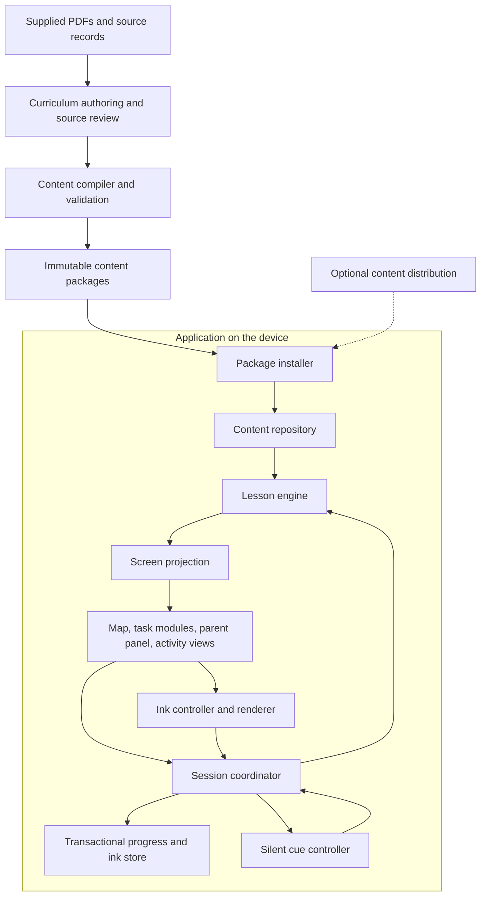

# Architecture: Reading together

**Status:** Accepted production specification, reconciled October 16, 2026. Application implementation and real-driver/device acceptance remain outstanding.

The accepted Q1–Q21 decisions in [the design interview](docs/design-interview.md) and [ADRs](docs/adr/) govern this specification. The first public release is a free, parent-led Lessons 1–6 application for landscape iPad and Android tablets. Multiple local profiles, current-run Undo advance, protected complete backup/restore, and the full SPA functional gate are required. No login, purchases, cloud sync, ads, or third-party analytics are included. Publication arrangements remain an external release input.

**Product contract:** [PRD](PRD.md).

This document defines the production application for the initial six lessons and later user-supplied lesson batches. The existing wireframes and Lesson 1 interaction are design inputs. No production application or infrastructure is implemented by this document. Supplied PDFs, transcriptions, source-bearing design files and data remain local authoring inputs excluded from the public engineering repository. Publishing engineering documents/issues is separate from publishing book content or an application.

Normative appendices: [database contract](docs/architecture/DATABASE_CONTRACT.md), [technology inventory](docs/architecture/STACK.md), and [review acceptance cases](docs/architecture/ACCEPTANCE.md). This revision addresses the findings in [the October 15 review](ARCHITECTURE_REVIEW.md); its original findings remain a historical record. Specification changes and tests still required during implementation are distinguished explicitly.

## 1. Accepted architectural and product decisions

The proposed architecture has six concrete decisions:

1. A **local-first application** runs lessons and handwriting without a server connection after content installation.
2. A **modular application** separates curriculum, teaching state, ink, persistence, and presentation. These modules ship together; they are not separate services.
3. A **deterministic lesson engine** follows an authored teaching graph. Parent actions control instructional advancement.
4. A **dedicated ink renderer** handles high-frequency drawing input outside the lesson screen's ordinary rerender cycle.
5. A **transactional local store** commits progress and writing changes. Immutable content packages hold reviewed instructional material.
6. A **source-linked content compiler** produces the packages. Publishing new lessons changes curriculum data; new interaction capabilities require an application release.

The user has selected **React Native with Expo for multiplatform distribution**, with the entire application and its core logic implemented first as a **React SPA** for faster development. This is the first implementation of the production application. Native migration starts only after the full SPA functional gate in section 18 passes. It does not reduce the six-lesson production scope.

| Product choice                           | Architectural treatment                                                                                                                                                                                                                                                 |
| ---------------------------------------- | ----------------------------------------------------------------------------------------------------------------------------------------------------------------------------------------------------------------------------------------------------------------------- |
| Implementation and distribution          | React + Vite + TypeScript SPA first; React Native + Expo for subsequent iOS/Android distribution. The SPA is the development implementation; permanent public web support is deferred. Qualify iPad and Android tablet releases with a tested device/OS list.           |
| UI, data, and formatting                 | shadcn/ui for SPA controls, TanStack React Query for cached application read models, Drizzle ORM/Kit for SQLite access/migrations, Prettier defaults for formatting. No ESLint. See section 3.                                                                          |
| One child or multiple children           | Multiple local child profiles from v1. Namespace all personal records by stable `ProfileId` and generation. Names, photos and birth dates are not required.                                                                                                             |
| Child avatar during onboarding           | Store an optional stable bundled animal `avatarId` in profile preferences. The child chooses through illustrated radio cards after parent profile setup. Confirmation changes only that profile preference; the header and profile list resolve the same catalog asset. |
| Backup and device transfer               | Required passphrase-protected parent export/import includes saved work, unfinished teaching and exact runtime content for offline resume. Restore as new profiles with preview/rename.                                                                                  |
| Accounts, synchronization, and purchases | The free Lessons 1–6 release has no login, purchases or cloud sync. No ads or third-party analytics. The engine has no service dependency.                                                                                                                              |
| Parent pronunciation audio               | Reserve parent-reference media as optional content. Core teaching remains parent-led with silent pointing cues.                                                                                                                                                         |
| Distribution and content-use rights      | Track asset provenance and distribution approval in the publishing inventory. No permission or public-distribution scope is assumed here.                                                                                                                               |

All 45 tasks and real digital handwriting are required. Exact SDK versions, device floors, signing and publication arrangements require engineering qualification or external provisioning, not new product-preference decisions.

## 2. System boundaries



The app's teaching path contains no online request. The authoring environment contains source scans and review records; the runtime package contains only the reviewed curriculum and approved application assets it needs.

### Module ownership

| Module              | Owns                                                                               | Public surface                                        |
| ------------------- | ---------------------------------------------------------------------------------- | ----------------------------------------------------- |
| Content authoring   | Source mapping, editorial decisions, glyph and gesture review                      | Authored curriculum records and review manifest       |
| Content compiler    | Schema checks, graph checks, coverage, package construction                        | `compile`, `validate`, and a readable coverage report |
| Content repository  | Verified immutable lesson definitions and assets                                   | `openPackage`, `getLesson`, `getTask`, `getAsset`     |
| Lesson engine       | Current teaching position, repeat rules, correction routes, completion eligibility | `evaluate` and `project`                              |
| Session coordinator | Serialized commands, persistence barriers, lifecycle, effect ownership             | `dispatch`, `snapshot`, and `subscribe`               |
| Cue controller      | Monotonic timing and silent visual movement                                        | `start`, `cancel`, and generation-tagged signals      |
| Ink controller      | Pointer ownership, stroke edits, document layers, undo history                     | `begin`, `append`, `end`, `cancel`, and `edit`        |
| Ink renderer        | Immediate visual ink and reconstruction from a document                            | Input/render surface supplied by the platform adapter |
| Progress queries    | Map status, resume destination, task completion views                              | Read-only projections from committed records          |
| Local store         | Transactions, revisions, migrations, and personal record deletion                  | `commit`, `read`, and `migrate`                       |
| Package installer   | Verification, staging, installation, activation, retention                         | `install`, `activate`, and `collectUnused`            |
| Presentation        | Reading.com-inspired composition, source-aware text, accessibility                 | Screens render projections and send allowed commands  |
| Platform adapters   | Drawing surface, storage driver, lifecycle, files, and distribution                | Implement the contracts above                         |

Screens do not write database rows, decide that a response is correct, or interpret book prose as executable logic. High-frequency pointer samples reach the ink renderer directly. Committed stroke edits reach the session coordinator.

## 3. Selected technology and SPA-to-Expo boundaries

### 3.1 Implementation sequence

Build the complete React SPA using Vite and strict TypeScript: map, all 45 tasks, parent-led scripts/corrections/review, durable progress, offline packages, digital handwriting, and recovery. Only after all accepted SPA functional flows pass the handoff gate, add the Expo application and adapt screens, input/rendering, lifecycle, and storage bindings incrementally against the same contract fixtures. Native releases still require their own device/performance/recovery acceptance. SPA completion does not establish native input quality.

| Responsibility       | Initial React SPA                                                              | React Native / Expo                                                                                                                             |
| -------------------- | ------------------------------------------------------------------------------ | ----------------------------------------------------------------------------------------------------------------------------------------------- |
| Application shell    | React + Vite + TypeScript, React Router                                        | React Native + Expo + TypeScript, Expo Router                                                                                                   |
| UI                   | shadcn/ui and Tailwind CSS, with source-aware copy and shared design tokens    | Native components and approved custom lesson layouts using the same tokens/projections. DOM-based shadcn components require native equivalents. |
| Cached state / reads | TanStack React Query over committed local repository reads                     | Same query keys/read contracts, with Expo lifecycle/connectivity bindings                                                                       |
| Persistent state     | Drizzle SQLite schema/queries over a local worker bridge to SQLite WASM + OPFS | Same SQLite schema/migrations through Drizzle's expo-sqlite driver and expo-sqlite                                                              |
| Handwriting          | Canvas 2D + Pointer Events adapter                                             | Native/GPU adapter; Skia/Gesture Handler/Reanimated remain renderer candidates requiring device checks                                          |
| Offline content      | Service worker/application-shell cache + immutable CacheStorage content        | Bundled assets and Expo filesystem/asset adapters                                                                                               |

shadcn provides [Vite integration](https://ui.shadcn.com/docs/installation/vite); its generated DOM components stay in the web application. Do not wrap the final handwriting/lesson experience in a WebView to avoid implementing native input. Expo DOM components can be a temporary migration aid if separately justified, not the production ink contract.

### 3.2 State ownership with React Query

React Query is the selected React-facing cache and asynchronous data-state layer. It reads installed content, map/progress projections, preferences, and document summaries through repositories. The lesson engine/coordinator plus transactional SQLite store remain authoritative for teaching state and writing. Ordinary transient UI state uses local React state; live pointer samples stay in the ink adapter. Neither query cache nor React component state can declare parent acceptance or replace a committed receipt.

Query keys include profile/generation/course/package and relevant session/document IDs. Local SQLite reads use network-independent query execution; optional download queries follow connectivity. Mutations dispatch commands to the serialized coordinator. Disable automatic instructional mutation retries; explicit Retry resends the same command ID/hash. Update/invalidate affected read models only after commit, and reject delayed results from an old profile generation. A concurrent read cannot observe a partial transaction. Do not persist ink or the authoritative session solely in a query-cache persister, and do not optimistically advance teaching/completion. On native, wire AppState and connectivity into the query managers ([TanStack React Native guidance](https://tanstack.com/query/latest/docs/framework/react/react-native)).

### 3.3 Shared logic and replaceable adapters

Shared strict-TypeScript packages own content schemas/compiler contracts, source/copy provenance, pure graph engine, repeat/correction/review state, session coordinator, progress queries, canonical ink/history, and SQLite schema/migrations/repositories. Their public interfaces return data and promises; they import no DOM, Vite, React Router, React Native, Expo, or shadcn modules. React Query hooks live in a separate shared React integration package and depend on those interfaces, not the reverse.

Web screens and shadcn components stay under the web application; Expo screens/native controls stay under the Expo application. Platform adapters implement rendering/input, DB execution, lifecycle, files/cache, package verification, and time. Retain canonical ink and fixture identities across migration. Mobile screens render the same committed projections and send the same parent commands, preserving curriculum and added-copy highlighting. Code reuse is planned at these boundaries; no percentage of screen reuse is promised.

Drizzle supplies typed SQLite queries and generated SQL migrations, not ownership policy. Reviewed SQL adds composite/deferred constraints, partial indexes, and checks that its schema DSL cannot express. Keep one ordered checksummed migration ledger as defined in the database contract; do not run a second independent migration authority. Browser Drizzle's proxy boundary is a **local worker bridge**, not an HTTP backend. Serialize the entire transaction, including reads/validators, through commit; the native binding enforces the same unit of work. Driver/renderer versions and supported platform floors are pinned and validated during implementation. See the [technology inventory](docs/architecture/STACK.md).

### 3.4 Formatting and commit policy

Use Prettier's default options through the empty root configuration. Do not add ESLint, ESLint presets, or custom Prettier options. TypeScript checks, behavioral tests, and focused architectural checks provide their own validation. The root tooling provides `npm run format` and `npm run format:check`; Husky/lint-staged formats staged supported files and the hook checks all supported project files before a commit. Generated output/dependency directories and binary files are outside source formatting. No commit should bypass the formatting gate.

The repository has Git and a formatting hook. Keep the hook enabled. The current engineering baseline and high-fidelity viewer do not implement the production React/Expo application. The schemas below remain language-neutral descriptions implemented in shared TypeScript.

## 4. Curriculum model and source provenance

### 4.1 Stable identity and independent versions

Use stable identifiers for `Course`, `Lesson`, `Task`, `SourceUnit`, `TeachingNode`, `Item`, `Symbol`, and `Asset`. A display title or lesson number is not a database key.

Maintain independent versions for:

- Content schema: how a package is decoded.
- Content release: which reviewed material the package contains.
- Engine capabilities: which interactions the app can execute.
- Local database schema: how personal state is stored.
- Ink codec: how stroke documents are decoded.

Do not reuse an identifier for a different instructional meaning. A source correction gets a review record and a new content release. An active session retains its exact content release.

### 4.2 Core records

```text
CourseDefinition
    courseId
    orderedLessonIds
    contentReleaseId

LessonDefinition
    lessonId, order, titleCopyId
    orderedTaskIds

TaskDefinition
    taskId, lessonId, titleCopyId
    activityFamily, optional
    entryNodeId, nodes
    requiredMilestones
    sourceCoverage
    layoutEnvelope

TeachingNode
    nodeId, itemId, sourceRefs
    parentActionCopyIds, spokenCopyIds, expectedResponse
    speaker: parent | child | together | none
    pointerOwner: parent | child | none
    childPresentation
    cueSpec
    allowedParentActions
    nextEdge, repeatPolicy, correctionSpecs, reviewSpec?
    milestoneEffects

SourceReference
    sourceId, editionReference, printedPage, scanReferenceId
    lessonNumber, taskNumber, sourceStep, regionOrTextSpan

VisibleCopy
    copyId, spans

CopySpan
    text, emphasis
    origin: book(sourceRef) | adapted(sourceRef, reviewNote) | app(reason)
```

`activityFamily` selects presentation. The graph determines instructional order. Two tasks titled **SAY THE SOUNDS** can use different presentations and turn ownership.

`childPresentation` is a tagged union: oral listening, printed sound, printed sequence, rhyming initial symbol, or writing document. Each variant lists exactly what the child area may display. Expected oral answers belong to the parent projection, not the child target.

Keep printed symbols, oral sounds, and writing targets separate. For example, a long-e exercise can refer to an oral sound, a printed ē asset, and a plain-e writing asset. An oral prompt does not require that every sound's printed symbol has already been introduced.

Source speech can contain phonics notation. Gesture duration is a numeric `cueSpec` property with a source reference, not a value inferred from repeated letters such as `mmm`.

### 4.3 Copy rendering

All app-owned visible text passes through one source-aware text component. It renders book spans normally and added/adapted spans with the required highlight. Generated counters, navigation labels, errors, and helper copy are app-origin text.

Reject unclassified authored copy during compilation. A new runtime-generated label defaults to app-origin. Raw string props cannot bypass the text component in production screens. Platform-owned system dialogs remain outside the app's authored-copy contract.

Source spans point to approved source wording. A correction to an OCR error can remain book-origin when a reviewer verifies it against the scan and records the correction. The original transcription remains intact. Source instructions are plain curriculum data; packages contain no executable scripts, arbitrary HTML, or expressions evaluated from book text.

`scanReferenceId` belongs to the authoring catalog; it is not a runtime asset path. Runtime provenance retains stable source identifiers and page references. Ship a scan excerpt only when it is an explicitly reviewed runtime asset. Private source paths are never embedded in a package.

### 4.4 Glyphs and gestures

Use audited glyph/diagram assets with accessible sound labels. System-font substitution must not drop a macron, alter a teaching glyph, or remove an instructional arrow. A missing instructional asset is a content error.

Assets describe logical positions for symbols, start balls, hold points, and arrow endpoints. The renderer applies the layout transform. Hold intervals, rapid movements, and connected segments remain explicit. The compiler checks source-specific timing and gesture ownership.

## 5. Teaching graph and session engine

### 5.1 Engine contract

The engine is a pure function of installed content, committed session state, and a normalized action. It has no database, network, wall-clock, or rendering dependency.

```text
LessonEngine.evaluate(content, session, action) -> TransitionPlan | Rejection

TransitionPlan
    proposedSession
    progressChanges
    requiredInkBarrier
    effectsAfterCommit

LessonEngine.project(content, committedSession) -> ScreenProjection
```

Actions include parent Continue, Repeat, Help, Back, Pause, optional SkipWriting, source-prescribed readiness confirmation, UndoAdvance, SelectReviewItems, ConfirmReviewItem, and cue/ink signals. Child touches and ink signals do not declare a correct spoken response.

Each parent command carries a scope/command identity, profile generation, expected revision, and canonical payload hash. The coordinator serializes commands. A matching retained receipt returns its prior result; identity reuse with a different payload is rejected. Stale revision/generation cannot advance the next step or recreate deleted work. See the database contract's transaction and identity protocols, including administrative scopes.

### 5.2 Flow semantics

- **Continue:** accepts the current source-prescribed instruction or response and follows its allowed edge. Required subsequent responses remain separate nodes.
- **Repeat:** repeats the current item or authored practice group. It does not skip to the next item.
- **Help:** cancels an active cue, enters the applicable correction graph, and records its explicit retest destination.
- **Correction repeat:** stays within supported practice until the parent confirms the source's readiness condition.
- **Back:** restores the preceding instructional checkpoint, including its item and branch context. It does not reset the task to its model screen.
- **Pause:** retains the current task and branch. An interrupted cue restarts on resume.
- **SkipWriting:** records an explicit skip for an optional task. It does not mark writing completed or mastered.
- **Replay:** creates a new task run without erasing earlier valid completion credit.
- **Undo advance:** withdraws the latest accepted advance in the child's current task run. It can undo a just-completed task, survives restart, and stops at that run's start. Starting another run for that child closes the earlier undo window.
- **Selective review:** at a source-authored review node, the parent chooses earlier items to revisit. Help usage may suggest a choice but never determines it. The saved queue has its own current item, correction return, and authored exit.

Repeat policies distinguish a required **Again** step, a source-specified count/range, and parent-confirmed repeat-until-firm practice. Qualitative source instructions are retained for the parent; the engine does not invent a passing count.

Task completion requires its authored milestones. Milestones represent delivered, parent-accepted instructional units. They do not measure learning mastery. Initial lesson satisfaction derives from all core tasks being complete and each optional task being complete or skipped; valid task credits support durable lesson credit across replay and content edits. Undo can withdraw credit earned only by the current run while retaining earlier valid credit (§8.5).

The typed obligations below implement these distinctions. A generic Repeat button cannot replace required source nodes or end-of-task review.

### 5.3 Concrete Lesson 1 correction example

For Task 1, the normal sequence retains the m model, first child response, repeated response, praise, and then the s sequence. The m correction returns to the source's first child-response step for m. It does not advance to s or add an unprescribed together turn.

A cue finishing changes cue readiness only. The parent still judges the spoken response. The same rule applies to touch accuracy and drawing activity.

### 5.4 Timing and cancellation

`CueController` uses a monotonic clock and a generation token tied to session, node, and cue run. Help, Back, Pause, navigation, or backgrounding cancels the generation. Late callbacks from canceled generations are ignored.

Store the interrupted teaching position, not a half-expired timer. On resume, rebuild the cue from its start. Consecutive sound segments use one uninterrupted cue timeline where the source requires continuous blending.

Reduced-motion presentation preserves the hold and transition meaning without changing advancement rules. Child-controlled pointing supports the source gesture; the parent remains responsible for evaluating coordinated speech and movement.

### 5.5 Persisted teaching, repeat, correction, and review contracts

The following tagged records are language-neutral. IDs reference the exact pinned package; optional values are marked `?`. All counters are nonnegative integers. The content compiler checks every referenced entry, exit, retest, item, and source citation.

```text
RepeatPolicy =
    none
    | requiredAgain { authoredNodeIds, sourceRefs }
    | counted { groupEntry, groupExit, minCycles, maxCycles?, sourceRefs }
    | untilFirm { groupEntry, groupExit, readinessCopyId, sourceRefs }
    | qualitative { groupEntry, groupExit, instructionCopyId, sourceRefs }

RepeatState
    policyNodeId, occurrenceId, completedCycles, cycleOccurrenceId
    parentReady, pendingExit

CorrectionSpec
    correctionId, selectorId, eligibleNodeIds, entryNodeId
    retestNodeId, retestExitNodeId, sourceRefs

CorrectionContext
    correctionId, triggerNodeId, triggerItemId?, triggerOccurrenceId
    retestNodeId, retestExitNodeId, savedRepeatState?
    reviewQueueId?, reviewIndex?, continuationNodeId

ReviewSpec
    reviewNodeId, eligibleOrderedItemIds
    itemRoutes[{itemId, entryNodeId, exitNodeId}]
    returnNodeId, exitNodeId, sourceRefs

ReviewState
    queueId, reviewNodeId, selectedOrderedItemIds
    currentIndex, confirmedItemIds, status: selecting | practicing | done
    returnNodeId, exitNodeId

TeachingState
    nodeId, itemId?, occurrenceId, nextOccurrenceNumber
    acceptedMilestoneOccurrences, repeatState?, correctionContext?, reviewState?
    writingState?{targetId, phase, confirmedTracingTargetIds,
                  confirmedIndependentTargetIds}
    checkpoints[{checkpointId, nodeId, itemId?, occurrenceId,
                 repeatState?, correctionContext?, reviewState?}]
```

`requiredAgain` references distinct authored nodes, each requiring its own acceptance. A counted policy increments only after the parent accepts a whole cycle's exit. Before minCycles, Continue routes to another cycle; from minCycles to maxCycles the parent may repeat or exit; at maxCycles it exits. If the source gives an exact count, min=max. Neither a failed response nor a correction cycle increments that independent-practice count. UntilFirm requires explicit parent readiness; qualitative preserves the source instruction and lets the parent choose Repeat/Continue without inventing a threshold. Finishing a cue never increments these counters.

Help exposes only source-authored correction selectors applicable to the current node. Choosing one saves its trigger, suspended repeat/review state, prescribed retest range, and continuation. The source may require returning to an earlier independent-response step: encode that retest range explicitly. Once parent-accepted retest reaches its authored exit, restore the saved context and continue through the specified route; do not treat supported correction practice as acceptance of unrelated future nodes. Correction subgraphs cannot recursively push arbitrary Help frames; repeated support stays in the current correction until its prescribed retest/exit.

Selective review is required at **Lesson 1, Task 2, Step 8** and **Lesson 2, Task 2, Step 9** ([source transcription](output/markdown/lessons-01-06.md)). At these nodes present the eligible items to the parent, allowing nonadjacent selections independently of previous Help/Repeat actions. Display only parent-facing review controls, with added labels highlighted. Store stable item IDs ordered by source order, not tap order. Selection is committed before entering the first chosen item. Empty selection requires the parent's explicit confirmation and follows the authored exit; it does not manufacture a correct response. Once practicing, the queue is immutable; revising it means returning to selection through an authored route. `returnNodeId` names that source review-selection position; `exitNodeId` names the normal-path continuation after review. Neither is inferred from the last selected item's array index.

ConfirmReviewItem is accepted only at the current item's route exit after its required substeps. It records that item once, advances the saved index, and enters the next selected item. Help saves the queue/index and returns through that item's retest/exit before the next item. After the last item, mark the queue done and follow exitNodeId. Pause/restart restores this exact queue, partial item, and correction context. Example: motorboat and sister selected in Lesson 1; after motorboat is confirmed, restart opens sister's saved position, not the final ordinary item or motorboat again. These review routes point to supplied curriculum, not new teaching text.

Back restores the preceding checkpoint's program position and repeat/correction/review context; it retains already accepted occurrence IDs and durable task results. Reaccepting the same occurrence is idempotent and does not double-count a cycle or milestone. A **new** repeat cycle allocates a new occurrence; required future Again nodes still have separate IDs. Rewinding into a review item restores its queue cursor so the parent can revisit it; existing confirmation does not auto-skip the screen. Forward reconfirms the same occurrence without increasing result counts. Checkpoint restoration does not rewind drawings or document phase: a restored earlier writing view is read-only with respect to later layers; an explicit replay creates fresh editable writing. Current task-run state, including these contexts, is saved transactionally. Back never withdraws an advance. Undo uses the separate persisted acceptance chain described below.

Run completion checks required node/milestone occurrences in the normal authored path, plus explicitly required repeats and review exit. Back cannot create an unmet obligation by erasing historical acceptance, nor can prior support satisfy a distinct future obligation. Replay creates a new run with fresh occurrences, counters, contexts, and writing documents; earlier valid credits remain authoritative. A content-state migration must map every saved node/item/occurrence, policy, selector, checkpoint, review item, and return route, then validate obligations. If any mapping is missing or changes its instructional meaning, retain the old package/session instead of guessing by array index.

### 5.6 Current-run Undo advance

A profile has one `undo_run_id`, shared across courses and sessions. Pausing, restarting the process, switching profiles, viewing the map, or changing an avatar preserves it. Explicitly starting another task run for that child replaces the pointer and permanently closes the earlier undo window. Merely previewing another task does not start a run. Advancing to the next task requires an explicit parent start after the completion view, so the just-completed run remains undoable there.

Each newly accepted teaching turn appends a durable `task_advance` record with its run, monotonic sequence, preceding active advance, command identity, and complete before/after teaching state. The snapshot includes occurrence/milestone acceptance, repeat/correction/review context, checkpoints, writing target and phase confirmation state. It excludes canonical ink bytes. Accepted skip is a terminal reversible action for optional writing. Reconfirming an already accepted occurrence after Back does not append a second acceptance or duplicate a milestone.

Undo validates the profile pointer and latest active advance under the same transaction as its reversal. It restores that record's before-state, marks the acceptance withdrawn, withdraws any terminal task credit it created, and invalidates lesson credit whose exact support depended on that task credit. The transaction recomputes effective task/lesson results from remaining valid credits, restores an active current run/session when undoing terminal acceptance, updates the cursor, advances revisions/input epochs, and commits the command receipt. Earlier valid runs continue to contribute credit. A failed transaction changes none of these records. Duplicate Undo retries return the same receipt and cannot undo an additional turn.

Repeated Undo follows the prior active advance until the run's start. New acceptance after Undo allocates a new sequence and branch; withdrawn acceptances remain non-contributing records, never an implicit Redo. Back, cues, Help previews, avatar edits and ink edits are not parent acceptance and do not shorten this chain. Explicit Restart creates a new run and closes the old chain.

Undo preserves all saved drawings and edit history. Reopening an earlier writing phase changes teaching confirmation only. Later-phase ink remains saved and is read-only outside its phase. Existing ink does not automatically satisfy a withdrawn phase confirmation. Phase/input epoch changes fence stale callbacks, and the parent can confirm again or start a fresh run. The current run's undo records cannot be pruned with bounded command receipts; they remain until its undo window closes, then only records needed by valid credit/backup provenance remain.

## 6. Coordinator, commands, and durable advancement

`SessionCoordinator` owns the live application session. Views use a small interface:

```text
ApplicationSession.dispatch(command) -> CommitReceipt | SaveError | StaleRevision
ApplicationSession.snapshot() -> ScreenProjection
ApplicationSession.subscribe(listener) -> unsubscribe
InkController.flushPendingEdits() -> CommittedDocumentRevision
```

Normal advancement follows this order:

1. Validate command identity, current revision, ownership, and allowed action.
2. Cancel incompatible transient effects.
3. If writing is involved, synchronously close its input fence, finalize any active pointer, and flush its pending document edits.
4. Evaluate the lesson transition against committed state.
5. Recheck owner/generation, session/run identity, document revision, phase, and input epoch inside the transaction. Commit session, run state, progress changes, document phase/epoch, and command receipt together.
6. Publish the new screen projection, reopen input for its committed phase/epoch if allowed, and start permitted effects.

Display changes to teaching position follow a successful commit. Immediate ink rendering and cue cancellation remain responsive while a save is pending. A save failure does not publish false completion or silently navigate away from unsaved writing.

The store checks revisions within the transaction. Native apps use one serialized writer. A web binding also coordinates multiple tabs; a second tab cannot independently overwrite the active session. Revision checks remain the final defense even when a tab-owner mechanism is used.

The coordinator retains enough command history for retries. Idempotency receipts can be bounded because stale revisions still reject old commands after receipt cleanup.

The input fence rejects new pointer-down events during flush and transition; it never assigns them to either phase speculatively. Queued append/end events carry the epoch in which their gesture began. Advancing phase, reset, or restart invalidates the old epoch, so late callbacks are rejected even if their document still exists. After a save failure keep the fence closed, preserve the live buffer, and allow an idempotent Retry. Reopen only after recovery confirms committed document/phase state; a timeout alone is insufficient. Parent Help cancels the cue immediately and can show a read-only source correction preview while its commit waits, as specified in §12.

## 7. Digital handwriting architecture

### 7.1 Document and layers

Each writing target/run owns an `InkDocument` with four logical layers:

1. Source-derived line guides and optional reviewed letter outlines.
2. Parent demonstration strokes, editable during the model phase.
3. Separate child tracing and independent-writing stroke layers.
4. Transient live preview, including any renderer prediction.

The first three have persistent representations. Predicted points never become saved evidence of a stroke. The source writing sequence chooses the current target; ē's writing target is plain e.

The writing phase is `parentDemonstration`, `childTracing`, or `childIndependentWriting`. Promoting a parent demonstration to a tracing guide preserves its strokes. Clearing the current child phase does not clear the other child phase, parent model or source guides. Tracing repetitions and independent practice remain parent-confirmed source activities. Confirm tracing once per source target and independent writing once per target. Show the prescribed practice counts and allow further practice. A stroke or letter count never generates confirmation.

### 7.2 Canonical coordinate space

Store strokes in a fixed logical document coordinate space with its own width, height, and origin. For a viewport, calculate one uniform scale:

```text
scale = min(viewportWidth / documentWidth, viewportHeight / documentHeight)
viewportPoint = documentPoint * scale + centeredOffset
documentPoint = inverseTransform(pointerPoint)
```

This preserves aspect ratio during rotation and resizing. Multiplying x and y by unrelated new canvas dimensions would distort the letters. Device-pixel ratio changes rendering resolution, not the saved geometry.

Rotate or resize during a gesture by finalizing the confirmed partial stroke, releasing the pointer, and rebuilding the transform. Do not connect the old gesture to a new coordinate system.

### 7.3 Portable stroke contract

```text
InkDocument
    documentId, profileId, generation, taskId, runId, targetId
    packageHash, contentReleaseId, sourceRefs
    phase, logicalBounds, documentRevision, inputEpoch, inkCodecVersion
    modelLayer, tracingLayer, independentLayer, historiesByLayer

InkStroke
    strokeId, documentId, layerId
    confirmedPoints: [{x, y, elapsedTime, optionalPressure}]
    brushSpec: {kind, widthInDocumentUnits, colorRole, cap, join}
    status: capturing | finished | interrupted
```

Use a simple readable brush that works without pressure. Native payloads may be stored as an acceleration or fidelity cache, but an opaque SDK blob or flattened bitmap cannot be the only representation. An adapter must export confirmed stroke geometry and reconstruct it through the canonical codec. Test conversions against the actual supported renderer.

Very long gestures can use multiple point chunks under the same `strokeId`. Chunking is a persistence detail; it does not introduce visible gaps or count as extra letters. Simplification must preserve visible shape and pass fidelity tests.

### 7.4 Input and rendering path

Pointer samples update a live path in the ink adapter's rendering path. They do not trigger an entire lesson-screen render or a database write per point. The adapter maintains one active drawing pointer, uses supported platform palm rejection, and handles additional contacts and cancellation explicitly.

The web binding uses pointer capture and disables browser gesture handling only on the active writing surface. It handles both pointer release and cancellation. These behaviors are documented by [MDN Pointer Events](https://developer.mozilla.org/en-US/docs/Web/API/Pointer_events).

On stroke end, enqueue a semantic edit for persistence. Backgrounding or cancellation preserves a recoverable confirmed partial stroke. The proposed checkpoint interval is at most one second during a long gesture, with checkpoint work off the input/render path. Only committed checkpoints are durable. A process killed before its first stroke/checkpoint commit cannot be promised to preserve that unsaved input.

Checkpoints update confirmed points under the same stroke identity; they do not create an undo entry per checkpoint. Persist the three-state status explicitly. Recovery atomically converts a capturing stroke with confirmed points into interrupted and inserts its missing AddStroke exactly once, using a unique origin-stroke identity. Repeated recovery creates no additional entry. Empty captures are removed. The original pointer never resumes after process recovery. Chunk ordering, codec, finalization transaction, buffer bounds, and corruption behavior are normative in the [database contract](docs/architecture/DATABASE_CONTRACT.md#stroke-chunks-recovery-and-undo).

### 7.5 Undo, redo, and clear

Persist a small document edit history with operations such as AddStroke, RemoveStroke, ReplaceModel, and ClearPractice. Clear records the affected child strokes so undo can restore them. Undo/redo operate on the active phase layer and writing run. Tracing and independent ink have distinct persistent layers/histories, so returning to tracing cannot edit later independent work.

The application owns one authoritative history. Platform undo controls must delegate to it rather than maintaining a divergent second stack. Programmatic document restoration carries a revision token so the adapter does not report restored strokes as new user input.

Deleting saved personal data purges strokes, history, previews, and pending writes. A practice-area Clear is a reversible edit, not that deletion operation.

Each layer has a persisted baseline, cursor, tip, and monotonically allocated operation sequence. Editing after Undo discards its redo suffix atomically; restart cannot restore that discarded branch. Retain the newest 128 operations per layer and compact older applied operations into a durable visibility baseline. The database contract defines collection of unreferenced stroke bytes and point/document/buffer limits. Reversible Clear retains payloads for Undo and cannot be offered as a disk-full remedy. Older saved replay drawings are removed only through explicit parent cleanup, while durable task outcomes remain.

### 7.6 Completion and ergonomics

The parent confirms the source's practice and feedback. No geometric score, stroke count, or ink coverage percentage completes a lesson. Free writing remains a separate phase after tracing.

The renderer and layout support left-handed placement, finger occlusion, a visible faint guide, generous line spacing, and readable ink thickness. Tools remain outside the drawing surface. These are implementation details to verify on supported devices, not new teaching instructions.

The PRD target is p95 input-to-visible-ink latency of at most 50 ms during a 30-second writing run on each minimum supported device. Measure input and presented-frame timing in a common clock domain. Record aggregate timings without stroke geometry. Framework frame callbacks are a proxy for display presentation; physical-device measurements must document that limitation.

## 8. Local storage, progress, and crash recovery

### 8.1 Logical storage schema

The normative [database contract](docs/architecture/DATABASE_CONTRACT.md) defines **every field's type/nullability**, primary/composite keys, enums, cardinality, indexes, ownership, deletion rules, and binding parity. Its records are installation, profile, installed_package, course_activation, course_cursor, session, task_run, task_advance, task_credit, task_result, lesson_credit, lesson_result, ink_document, ink_stroke, ink_point_chunk, ink_history, ink_operation, command_receipt, and schema_migration. Names are logical; either adapter must enforce the same invariants.

Child avatar selection follows parent profile setup and uses the profile-preference transaction boundary. Eight original bundled animal portraits form a labelled radio group with visible selection and keyboard focus. The pending choice stays local until Continue; Back/Cancel leaves the saved avatar unchanged. The confirmed portrait appears in the header and profile list. Parent-gated Change animal can edit a different child without switching the active child. Stable IDs, not duplicate display names, identify the edited profile. `LocalPreferences.avatarId` is an optional stable catalog key, not a file path or remote image URL. The platform UI resolves it through bundled original artwork. A missing or unsupported key renders a default animal without silently rewriting the saved value. An explicit confirmed choice commits with the profile identity, generation and expected revision. Cancelling does not write. Complete profile backup/restore includes the preference. Avatar changes never advance, reset or reassign sessions, results or ink. The current HTML design models this in memory; it does not implement the production transaction or persistence contract.

A session stores **current_run_id**. Creating or assigning a run commits atomically with that association; restart follows it directly. The run owns teaching/checkpoint/review state and its documents. Composite ownership includes profile/generation/course/package/lesson/task, preventing a valid document ID from being attached to another profile's run.

`task_credit` retains each run's terminal parent acceptance independently of bounded command receipts. `task_result` is its transactionally maintained effective projection. Completed dominates skipped among valid credits; unfinished replay contributes nothing. Undo can remove only the current run's contribution. `lesson_credit` snapshots the exact supporting task-credit identities; `lesson_result` projects remaining valid lesson credit. Package indexes and thumbnails are rebuildable; personal results and strokes are not disposable caches. All asynchronous personal writes carry their profile generation. Reset/delete cancels input/effects, invalidates generation, and transactionally removes the owned graph; stale work cannot recreate it.

### 8.2 Expo native storage binding

Use one SQLite database through **expo-sqlite and Drizzle's expo-sqlite driver** for personal state and command transactions. The native configuration is WAL mode with `synchronous=FULL`, tested on the pinned Expo SDK/driver and minimum hardware. SQLite documents transaction atomicity and the WAL durability difference between FULL and NORMAL. See [atomic commit](https://www.sqlite.org/atomiccommit.html) and [WAL behavior](https://www.sqlite.org/wal.html). Drizzle documents [Expo SQLite integration and migration generation](https://orm.drizzle.team/docs/connect-expo-sqlite).

Enable and verify foreign-key enforcement on each connection before any transaction. Use composite constraints and deferred current-run links, with transactional validators for content and typed state as defined in the database contract. Pin the Expo SDK-compatible driver and its minimum SQLite feature floor; no application schema has been implemented yet. Keep synchronous native driver transaction callbacks synchronous where required, and serialize their full execution through the store. Chunk/batch writes off the per-point input path; measure native ink responsiveness while saving.

Avoid dividing a writing commit between a database row and an uncoordinated personal file. Store initial stroke payloads in the database; a future file-backed format needs its own recoverable publication protocol. Immutable lesson assets use the package installer protocol in section 9.

Database backup uses a consistent database snapshot through the selected driver's supported backup mechanism. Copying the main file of a live WAL database is not a backup design.

### 8.3 Web storage binding

Use **SQLite WASM in a dedicated worker, persisted to OPFS**, through a local Drizzle SQLite-proxy adapter. This replaces the earlier IndexedDB personal-store option and keeps the SQLite schema/query semantics portable to Expo. The bridge adapts SQL parameters/results/BLOBs and holds one connection's writer/read queue across the whole transaction. A resolved SQL request is not a save receipt: resolve only after COMMIT succeeds. No network or unrelated awaited work occurs inside a transaction.

Select SQLite's opfs-sahpool VFS with one owning worker/connection, rollback journal (`journal_mode=DELETE`) and `synchronous=FULL`; validate effective pragmas and durability on supported browsers. This is a browser-specific journal choice, not a claim that native WAL settings apply unchanged. Coordinate origin ownership before opening; a second tab shows the ownership/retry state instead of racing to initialize another DB. Gate start on supported durable storage APIs. If unavailable, show the highlighted unsupported-storage state; never silently substitute memory/localStorage or an incompatible IndexedDB schema. SQLite describes [OPFS persistence and locking constraints](https://sqlite.org/wasm/doc/trunk/persistence.md).

Browser quota, permission, eviction, and origin changes still constrain persistence. Request persistence where available, handle refusal and failed writes, and document tested browser floors; see [storage quotas and eviction](https://developer.mozilla.org/en-US/docs/Web/API/Storage_API/Storage_quotas_and_eviction_criteria). Include worker/WASM assets in the offline shell. Verify content CacheStorage separately from the personal SQLite store. A native app cannot automatically open a browser origin's OPFS database: code migration and parent data transfer are separate concerns. The required protected backup/restore path supports deliberate browser-to-native transfer only after cross-binding round trips pass. Installing Expo alone does not transfer browser work.

### 8.4 Recovery states

At startup, open/migrate storage, validate personal records, load the session's pinned package, rebuild documents, and then project the resume screen. Do not start old timers automatically.

If a save fails, retain the in-memory document and show an app-origin parent error with Retry. Pause advancement and further unsaved changes until storage recovers. Never replace corrupted or unreadable personal data with a fresh empty database without an explicit recovery action.

A migration runs transactionally where possible and has preconditions, fixtures, and rollback/recovery behavior. Keep content release migration distinct from database migration. Irreversible storage changes constrain application rollback; a release cannot promise that an older binary reads a newer incompatible schema.

### 8.5 Deterministic map, task access, and resume queries

The map recommends curriculum order without enforcing lesson or task locks. Every installed, verified, compatible lesson/task is available through an explicit parent override. Unseen earlier work stays incomplete. The engine validates content availability and preserves every required turn within a selected run; it never infers completion from access or a future-task start.

A task is satisfied by a valid completed credit, or a valid skipped credit only when the task is optional. The effective `task_result` selects completed before skipped with deterministic retained acceptance identity. When all tasks in the pinned lesson are satisfied, create a `lesson_credit` with the exact task-credit support and package/task snapshot. Editorial additions do not invalidate that old curriculum snapshot. Undo of a supporting acceptance can invalidate its dependent credit, while a lesson credit supported by earlier valid runs remains. An unfinished replay cannot downgrade either projection. These are curriculum-delivery receipts, not mastery measurements.

The map lists available lessons in source order with truthful progress. Its recommendation is the first unsatisfied core task or optional writing decision in the first unsatisfied lesson. All satisfied work stays replayable. Optional writing remains in source order; explicit Skip records omission without claiming completion. Lessons not yet supplied and packaged are unavailable. Added map/status wording is highlighted.

Resume follows `course_cursor.resume_session_id` to that exact pinned package, `current_run_id` and saved context. The pointer may identify a closed terminal session while its current run owns the profile's open undo window. This restores a completion view with Undo after restart. Otherwise Resume identifies an active/paused owned session. There is no newest-by-time heuristic. Selecting/resuming a session atomically pauses the prior active session and allocates a unique course selection sequence. Profile switching fences old input and callbacks while preserving each child's cursor, undo pointer, progress and ink.

Selecting an existing live scope resumes it without creating another run. Explicit Restart abandons its unfinished run and creates a fresh run. Explicit replay of closed work creates a fresh session/run with the active compatible package. Existing saved sessions retain their exact package. A TaskReplay ends at that task's completion view. LessonReplay and progression offer the next source-order task, but do not begin it until the parent explicitly starts it. This action closes the prior run's undo window. Replay uses fresh occurrences and does not auto-skip required turns because earlier valid credit exists.

`return_session_id` is a same-child navigation hint. Returning to the map or a saved return session does not start another run or close Undo. Resuming an older paused delivery preserves its unfinished context and remains writable, but its closed Undo window never reopens. Only the last newly started run for that child can expose Undo. The parent UI shows Undo availability from this persisted pointer and active head; a superseded run shows no enabled Undo control. Historical completed work is viewed read-only or explicitly replayed as a new run. Resume selection is explicit. If no saved destination exists, show the first unsatisfied recommendation. A missing pinned package preserves the pointer and offers exact-package repair, never substitute teaching.

## 9. Immutable packages, offline installation, and updates

### 9.1 Package contract

A package manifest includes:

```text
PackageManifest
    formatVersion, courseId, contentReleaseId, packageHash
    contentSchemaVersion, requiredEngineCapabilities
    curriculumEntry{path, hash, byteLength, mediaType}
    lessonIds, assetEntries[{assetId, path, hash, byteLength, mediaType}]
    sourceReviewManifestHash
    compatibilityAndProgressMappings
    signingKeyId, signature
```

Hashes detect changed bytes. A release signature authenticates the publisher of a downloaded package. Application releases ship the trusted verification keys; signing secrets remain in the publishing environment.

Use the exact RFC 8785 UTF-8 body/envelope format, SHA-256, Ed25519 signing bytes, and trust-key representation in [the technology inventory](docs/architecture/STACK.md#signed-bytes-and-artifacts). The body contains curriculum and asset hashes; its hash excludes the packageHash/signature fields. The signature covers the canonical unsigned envelope containing body, packageHash, format version, and key ID. Reject noncanonical/ambiguous wire encodings and unknown mandatory fields; key rotation and revocation require an explicit trusted release policy.

The initial application bundles Lessons 1–6 and their runtime assets. A web release obtains and verifies its offline package during installation. It becomes offline-ready only after that operation succeeds. Later batches can arrive with application releases or an explicitly configured distribution service.

**Course composition is cumulative.** Each newly activated package contains every previously released lesson ID in source order plus the newly supplied lessons, with the full runtime asset closure. A Lessons 7–12 source batch produces a Lessons 1–12 package; a 7–12-only package cannot replace course activation. Compiler and activation checks enforce that no previously released lesson disappears or changes identity/order. This release includes only the supplied 1–6; no later lessons are authored now. Content-addressed asset files may be deduplicated without creating implicit package dependencies. Offline readiness covers the entire active cumulative course package and the application shell, not merely its newest batch.

### 9.2 Installation protocol

1. Stage the manifest and assets under an inactive package identity.
2. Validate signature, schema, required capabilities, declared sizes, paths, asset hashes, graph, and release metadata.
3. Reject path traversal, unexpected file types, unbounded archives, and undeclared executable content.
4. Finish staging all required runtime assets. Preserve the currently active package throughout.
5. Publish immutable package bytes with the platform protocol below, then transactionally record verified readiness.
6. Atomically change the course's activation record for new sessions.
7. Collect unreferenced staging artifacts and old bytes only after checking active/fallback activation, every retained task run including terminal runs supporting historical credits, retained documents, and rollback retention. Retained personal state pins its exact verified runtime bytes even after its Undo window closes, because import/migration validates its source membership. Closing a run or deleting only its drawings does not release this pin. Explicit personal reset/deletion may remove references; recheck all remaining owners before collecting shared bytes.

**Native publication:** write under a staging directory on the same volume; verify every file and manifest, flush files and directory metadata using the selected OS's supported durability primitives, then atomically rename to a content-hash directory. Only after publication succeeds may a DB transaction mark ready. A separate activation transaction checks ready/compatible/cumulative again and updates active/fallback hashes and revision. The filesystem and DB are not one transaction; exact directory flush guarantees must be established by the selected binding.

**Web publication:** create an immutable CacheStorage namespace keyed by hash, populate and verify all entries, then mark ready in the OPFS-backed SQLite database; never claim CacheStorage has atomic directory rename. Keep application-shell resources in a versioned service-worker cache with a verified shell manifest, including DB worker/WASM assets. Do not report offline-ready until shell and curriculum closures are present. Activation is a separate SQLite transaction. Browser eviction may later invalidate readiness.

**Restart reconciliation:** staged-but-present data is reverified and promoted or removed, never activated speculatively. Ready DB rows with missing/invalid bytes become missing before lessons open; retain exact IDs for repair. A published directory/cache with no ready row is an orphan: verify and register it inactive or collect it. A crash before activation leaves old activation; after activation use the new package only if still verified. If active bytes are missing, switch new-session activation to a compatible retained fallback only after a valid transaction and only if it contains every already activated lesson ID. A fallback from before a lesson expansion may fail this check: keep the catalog metadata and offer exact-package repair instead of dropping lessons. Sessions pinned to the missing hash remain paused pending exact repair. Never route such a session to fallback content. If neither package is usable offline, show the recovery actions in §12. Reconcile at startup and after installation/eviction errors; DB metadata alone cannot prove offline availability.

### 9.3 Updates during unfinished teaching

Pin every active session and writing document to its content release. Installing a new release does not change that session's current script, correction destination, glyph, or target halfway through teaching.

Content mappings distinguish added lessons, editorial changes, and changed flow semantics. Completion records retain the revision the parent completed. New required material can be offered as reviewed content; it does not silently relock completed lessons or relabel old work as newly completed.

Retain old package bytes while any live session or retained ink document needs them, including completed drawings' original targets/guides. An explicit validated migration may move those references. App compatibility must read every retained content schema, teaching-state version, and ink codec; do not stop supporting a format merely because its lesson was completed. Package activation and garbage collection are separate operations.

Missing capabilities produce an app-update state. A package cannot deliver remote application code to bypass an unsupported interaction.

### 9.4 Application and saved-state compatibility

Each application release declares readable DB/content/teaching-state/ink versions and includes decoders or validated migrations for every **published** version that can still own personal state. Upgrade fixtures include old correction contexts, partial selective review, capturing strokes, and completed ink documents. Old pinned packages must still render after a new binary opens the upgraded DB. Migrations preserve source identity, outcomes, and canonical geometry or stop in a recoverable state; no silent reset or index-based remapping.

| Binary / stored state                                  | Required behavior                                                                                                                                     |
| ------------------------------------------------------ | ----------------------------------------------------------------------------------------------------------------------------------------------------- |
| New binary + old DB                                    | Transactionally migrate from each published version, validate ownership and references, then resume. Inject failure before migration commit.          |
| New binary + current DB + old pinned content/state/ink | Read through retained compatible decoders, or perform a tested explicit migration preserving all saved routes/geometry.                               |
| Current binary + unsupported new content               | Refuse activation; retain compatible activation and all pinned work.                                                                                  |
| Older binary + newer incompatible DB/ink               | Refuse writable opening with an update/recovery screen; never initialize a new empty store. Use forward repair unless a tested downgrade path exists. |
| Completed old drawing + newest cumulative course       | Open the drawing with its original package/guides; a new replay uses the active package in a different run.                                           |

Release acceptance covers every supported combination, not only newest content on a clean install. Keep required old decoders/packages and fixture artifacts until all references have been explicitly migrated or removed by the parent.

## 10. Source authoring, review, and publishing

The existing [source JSON](/Users/tig/Desktop/tigran/readatthree/data/lessons-01-06.source.json) contains six lessons and 45 raw task records. Those records are not executable teaching graphs. The authoring process creates the graphs separately.

The pipeline produces these artifacts:

1. **Source catalog:** original source identities, file hashes, page/region references, and transcription notes.
2. **Authored units:** each spoken fragment, parent action, answer, pause, praise, repeat, correction, and instructional diagram maps to runtime units.
3. **Coverage report:** each source unit maps to one or more runtime units or a reviewed presentation decision. It detects missing later items inside a numbered step.
4. **Review manifest:** resolves ambiguous OCR and glyphs, approves wording/provenance, and records asset/distribution review status.
5. **Compiled package:** canonical curriculum data, source-aware copy, approved runtime assets, and compatibility metadata.
6. **Release manifest:** package identity, signature, validation results, and release notes.

The first content inventory expects lesson task counts `[6, 7, 8, 7, 9, 8]`, including six writing tasks. Counts are a coverage check, not sufficient evidence that every prompt is encoded.

Compiler checks include referential integrity, reachable required nodes, correction return points, valid repeat exits, exact task/item order, speaker and pointer ownership, optional completion rules, oral/printed separation, writing targets, timing references, asset presence, and copy provenance.

All instructional source mappings require review before publication. A reachable graph can still contain the wrong teaching words. Snapshot comparison and a human-readable source-to-screen report complement structural validation.

Ambiguous OCR remains a review error until resolved against the scan. In the current transcription, Lesson 2, Task 3, Step 6 needs that review. The source catalog retains the original text and the verified correction instead of silently editing the supplied record.

The authoring tool can begin as structured files and a local review command/view. A CMS is not required to keep content out of application code. Internal scans, absolute workstation paths, and public Reading.com screenshots do not automatically become runtime assets.

## 11. Screens, layout, accessibility, and parent controls

The production routes are parent preparation/profile onboarding, lesson map, title-first task modules, active session, completion, and gated parent settings/help. The routine path is map to task module to teaching. It never detours through parent documentation. The map has no sidebar, and task cards use semantic activity art rather than avatar portraits. A writing node renders within the active-session route; it does not create a second unrelated lesson-navigation stack.

`ScreenProjection` contains source-aware parent actions, speech, answers, child presentation, progress indicators, cue/ink configuration, and currently permitted controls. The UI cannot reveal a future target by reading ahead through arbitrary content records.

Reserve a layout envelope for each activity at the current viewport and text scale. It accounts for the longest applicable prompt, answer, hint/control row, symbol box, and canvas. Measure/reflow at a viewport or accessibility-scale change; reuse the envelope for model, child, repeat, and correction states within that activity.

Changing letters uses a stable symbol container. Writing tools, canvas bounds, and source line positions remain stable during phase changes. An operational error uses an overlay or reserved status area so it does not move the canvas while a hand is on the screen.

Tablet application layouts are landscape only. The SPA uses landscape tablet development viewports. Phones and portrait application layouts are deferred. Platform adapters request landscape where supported and inspect actual window dimensions. An unsupported portrait/undersized window fences input, finalizes confirmed partial strokes, cancels cues and shows a recovery view without advancing or losing state. Rotation/window enlargement returns to the same committed context. Exact supported device/OS/browser floors require qualification; a configuration flag is not proof of an OS lock.

All touch targets have non-overlapping hit areas. Separate parent navigation from child gesture regions. Settings, profile creation/switching/avatar changes, deletion, backup/share and external links use an accessible adult-reading gate. Routine teaching and Undo remain one-tap parent controls. That interaction prevents accidental access; it is not account authentication or evidence that the person is an adult.

Provide accessible names for parent controls, appropriate focus restoration, high-contrast ink/guides, scalable parent text, and reduced-motion cues. Automatic accessibility announcements describe turn status and controls without reading the expected answer during independent recall. Explicit parent focus can still inspect instructional content. Child speech is not captured by this architecture.

Parent preparation uses supplied guidance and diagrams. Parent-only pronunciation media, if selected, has source and rights metadata and explicit playback controls. It must remain separate from the child's independent response cue.

## 12. Lifecycle and failure behavior

```mermaid
sequenceDiagram
    participant Parent
    participant UI
    participant Coordinator
    participant Ink
    participant Engine
    participant Store
    Parent->>UI: Continue after writing
    UI->>Coordinator: Command with identity and revision
    Coordinator->>Ink: Close input fence, finalize pointer, flush edits
    Ink->>Store: Commit confirmed ink edits
    Store-->>Ink: Document revision
    Ink-->>Coordinator: Committed document revision
    Coordinator->>Engine: Evaluate parent action
    Engine-->>Coordinator: Proposed transition
    Coordinator->>Store: Recheck ownership/revisions; commit run, progress, phase/epoch, receipt
    Store-->>Coordinator: Commit receipt
    Coordinator-->>UI: New committed projection; reopen input for new epoch
```

Failure handling is explicit:

| Event                                         | Behavior                                                                                                                                                                   |
| --------------------------------------------- | -------------------------------------------------------------------------------------------------------------------------------------------------------------------------- |
| Parent opens correction during a cue          | Cancel the cue immediately. Show the applicable source script as a read-only preview while saving; only a committed correction context enables acceptance/retest commands. |
| App backgrounds during drawing                | Finalize confirmed partial ink, enqueue a checkpoint, cancel gestures/cues, and preserve the teaching position.                                                            |
| Process stops during a transaction            | Restore the last committed records. Never infer completion from an unfinished write.                                                                                       |
| Disk full or storage denied                   | Retain the live unsaved work where possible, stop advancement, and offer a clear parent recovery path.                                                                     |
| Missing or corrupt instructional asset        | Keep the current package/session identity; attempt verified repair or show unavailable content. Do not substitute another glyph or target.                                 |
| Unsupported content schema/capability         | Keep the last compatible package and show the required app-update state.                                                                                                   |
| A duplicate tap or stale timer signal arrives | Return the existing receipt or reject the stale revision/generation.                                                                                                       |
| Rotation occurs mid-stroke                    | Preserve the confirmed partial stroke and release input before applying the new document transform.                                                                        |
| Source content changes during a session       | Continue on the pinned release. New content applies to new sessions or a validated migration.                                                                              |
| Parent removes a profile's saved work         | Cancel its session and writes, invalidate generation, and delete all dependent personal records.                                                                           |

Lifecycle callbacks are not the only autosave mechanism. Stroke completion and parent commands save continuously because platforms may stop a process without giving a final callback.

### Parent recovery paths

Recovery controls, status labels, and explanation text are app-origin and highlighted under the existing copy policy. The parent always sees whether the displayed teaching context is committed. A correction preview retains the fixed activity anchors, includes a highlighted saving/error status, and cannot be mistaken for accepted progress.

| Condition                                             | Parent actions and preserved state                                                                                                                                                                                                                                   | Input / advancement                                                                                                                                                                                       |
| ----------------------------------------------------- | -------------------------------------------------------------------------------------------------------------------------------------------------------------------------------------------------------------------------------------------------------------------- | --------------------------------------------------------------------------------------------------------------------------------------------------------------------------------------------------------- |
| Slow save after Help                                  | Cue cancels immediately; show the source correction preview and save status. Preserve the original committed session plus pending command ID/context. Parent can read the preview while waiting.                                                                     | No acceptance, retest, phase change, or further drawing until commit. Reading the preview externally creates no inferred acceptance.                                                                      |
| Repeated save failure / quota denied                  | Retry the same pending command/ink batch; retain its buffer and IDs. Show failure category. Offer cache cleanup and parent-selected older-work cleanup when the store can safely commit it; no reversible Clear as storage cleanup.                                  | Fence new input and advancement. If cleanup also fails, keep the recovery view and unsaved preview; warn before a parent elects to leave/discard. Process death may lose only the still-uncommitted tail. |
| Corrupt/unreadable personal store or failed migration | Preserve original files/store. Offer Retry open, update application, or restore a validated consistent backup when the parent has a valid exported archive. Offer an explicit parent-confirmed Start fresh only as a separate destructive action, never the default. | No writes into corrupt state. A diagnostic/report contains only the allowlist. A backup is required functionality, but recovery still requires a valid parent-created archive and its passphrase.         |
| Missing/corrupt exact package while offline           | Preserve cursor, run, drawing, and immutable manifest reference. Offer Retry local verification, repair the **same hash** when connected, or return to the map without completing the task. A valid cumulative fallback can support new sessions only.               | Pinned session remains unavailable, not remapped. Package repair cannot overwrite personal records.                                                                                                       |
| Unsupported schema/ink codec, including app rollback  | Offer update/forward repair and show preserved-data status. Retain DB/package/codec metadata.                                                                                                                                                                        | Reject normal writable opening; no empty replacement store and no guessed decoding.                                                                                                                       |

Local restart recovery guarantees only the last successful transaction and committed stroke checkpoints, subject to the chosen storage platform's durability/eviction limits. Device loss, uninstall, browser-data deletion, or unrecoverable storage failure needs the required parent-created backup and its passphrase. Local transactions alone provide no device-loss recovery.

## 13. Privacy and complete protected backup

Progress and handwriting remain local. The free initial release has no login, purchases, cloud sync, ads or third-party analytics. No core feature requires a name, birth date, photo, microphone or upload. Optional local display labels do not establish identity. Diagnostics allow only versions, error categories, capabilities and aggregate timing. They exclude drawings, spoken responses, source text dumps, profile IDs and screenshots.

Data deletion covers personal records, teaching and ink history, temporary checkpoints, previews and app-controlled temporary exports. Shared curriculum is independent. Explain actual OS backup behavior and that the app cannot delete copies a parent has exported to another provider.

### 13.1 Export consistency and protection

After an accessible parent gate, the parent chooses profiles and a passphrase. Fence their input, flush confirmed ink, and take a consistent committed snapshot of profile preferences including avatar IDs, cursors, sessions/runs, current-run undo pointers and complete active advance chains, task/lesson credits and their support, effective results, documents/chunks/history, schema versions and owned state. Pause or serialize mutation while copying; never mix progress from one revision with ink from another.

The archive includes the complete exact runtime package/asset closure required by every exported saved teaching context and drawing, plus active course content needed for offline continuation. Include the exact packages referenced by historical completed/skipped runs and credit support even when they have no retained drawings or open Undo window; restore must validate those records too. It includes immutable verification metadata, not just download URLs. Original PDFs, scan/transcription development records, local paths, signing secrets, diagnostics and renderer caches are excluded. Only approved runtime content is eligible. Until content-use arrangements are recorded, engineering fixtures can test this path but no public content publication is claimed.

The versioned archive is authenticated and encrypted with the parent passphrase using the independently qualified format/KDF/crypto profile in [STACK](docs/architecture/STACK.md). Encryption covers the manifest, profile labels, work and content. Cleartext headers contain only bounded decoding/KDF parameters, nonce/salt and format identity. Reject unsupported or excessive parameters before expensive work. No passphrase, derived key, secret answer or recovery key is stored in the database, diagnostics or archive. No account service can recover a forgotten passphrase. Export is successful only after a complete authenticated archive is written and verified through the real file adapter. Remove app-controlled plaintext staging on success/cancel/failure and qualify that cleanup on both bindings.

### 13.2 Validate and restore as new profiles

Import runs outside writable teaching state. It validates archive limits, passphrase authentication, format versions, content signatures/hashes, codecs, source membership, complete ownership graphs, advance chains, valid-credit support and canonical ink/history. Paths cannot escape staging; archive files never execute. A corrupt, incomplete or unsupported archive changes no existing profile. Preview shows the profiles to create with optional rename and the exact content required. Cancel removes staging without a personal write.

Confirmation allocates fresh profile, session, run, advance, credit, document, stroke and command identities. It remaps every personal foreign key, cursor, return pointer, undo chain, credit-support edge and ink/history reference through one explicit mapping. Names never match or merge records. Stable source IDs, target IDs, content hashes and canonical geometry remain unchanged. Assign a fresh ownership generation and omit old executable command receipts. Preserve domain revisions and acceptance relationships so accepted revision checks remain valid; preserve provenance inside receipt data, recomputing hashes affected by local-ID remapping and retaining original receipt hashes for traceability. Imported retries from the exporting installation cannot execute against the new owner.

Install and verify the full runtime closure inactive before the personal import transaction. Then commit all selected new profile graphs and their validated projections atomically, with an installation-scoped idempotency receipt identifying the import operation. Publish no partial profile. An interruption before personal commit leaves original profiles untouched and staged content collectible; after commit the same import command returns its existing new IDs instead of duplicating profiles. Deliberately importing the same file again is a new operation that previews additional new profiles. Existing active selection and work stay unchanged until the parent selects a restored profile. Restore completes only when those new profiles can resume their pinned teaching and ink offline.

Backup format compatibility, cross-binding export/import and wrong-passphrase/truncation/resource-limit failures are required SPA and native acceptance. Native installation does not automatically read browser storage. Explicit protected transfer provides the tested path. Automatic cloud synchronization and any future commercial service require separate product decisions outside the lesson engine.

## 14. Future curriculum and extension boundaries

The supplied overview establishes later word reading, story reading, comprehension, covered pictures, and the transition to ordinary print. The architecture reserves these presentation concepts without authoring unavailable lesson content:

- A printed word/sequence representation supports distinct sound units, silent-letter treatment, and source-defined gestures.
- Rich text and glyph-style IDs support special phonics print and later traditional print.
- A story presentation separates text, illustrations, and source-authored reveal conditions.
- Comprehension prompts and expected answers stay in the parent projection.
- New activity capabilities join the renderer registry through an application release and matching content schema/capability checks.

These are extensions within lessons, not a standalone book/video/game library. Lessons 7–100 remain unavailable until supplied, reviewed, and packaged. The initial engine implements the actual patterns needed by Lessons 1–6, not 94 guessed lesson graphs.

## 15. Testing and requirement traceability

Testing is part of production delivery. No prototype milestone or educational-efficacy study is introduced.

| PRD requirements | Architecture mechanism                                               | Required test evidence                                                                                                          |
| ---------------- | -------------------------------------------------------------------- | ------------------------------------------------------------------------------------------------------------------------------- |
| C1–C2            | Source compiler, unit coverage, reviewed copy/glyphs                 | All 45 tasks and every source item mapped; scan review resolves ambiguities; approved text/diagram comparisons.                 |
| C3               | Typed copy origin and source-aware text component                    | No unclassified visible copy; additions remain highlighted in all themes and errors.                                            |
| F1–F3            | Authored graph and deterministic transitions                         | Correct model/together/child ownership, mandatory repeat/slow-fast pairs, every explicit correction and retest.                 |
| F4–F5            | Cue generations, monotonic timelines, physical-support presentation  | Prescribed holds and connected movement, immediate cancellation, no cue/touch signal counted as spoken correctness.             |
| F6–F7            | Checkpoints, pinned packages, task-run/credit separation             | Back, pause, replay, restart, optional skip, and completion semantics on each activity family.                                  |
| H1–H4, H9–H10    | Layered document and source-linked writing phases                    | All six writing tasks and target orders; parent model, tracing repetitions, independent writing, and parent completion.         |
| H5–H7            | Edit history, pointer ownership, canonical coordinates, transactions | Undo/redo/clear, palm/extra contacts, cancellation, rotation, interruption, and saved document reconstruction.                  |
| H8               | Dedicated ink rendering and timing instrumentation                   | Documented p95 measurement on each minimum supported physical device; include dense drawing and save activity.                  |
| U1–U5            | Shared lesson shell, layout envelopes, final assets, accessibility   | Map has no sidebar; fixed activity anchors; landscape tablet/window recovery and text-scale checks; no production placeholders. |
| P1–P4            | Local store, migrations, package activation, failure states          | Fault injection during saves/downloads/activation/migration; offline launch/resume; no false completion or silent data reset.   |
| P5–P8            | Device matrix, privacy diagnostics, release pipeline                 | Physical-device lifecycle/gesture tests, data-removal checks, signed/versioned builds, distribution and recovery procedure.     |

Engine tests use authored graphs and expected observable teaching positions. They do not only reproduce internal function calls. Property checks reject unauthorized edges, premature completion, invalid optional skips, and late cue effects.

Store adapter tests run the same contract suite against the SPA's real OPFS worker executor and the Expo SQLite driver. Inject failure before commit, during migration, after package staging, and before activation. Test browser tab/worker ownership contention and preserve typed BLOB/revision/result encoding across bindings. Ink tests reconstruct canonical strokes and compare geometry/appearance with tolerances declared for each renderer.

The [review acceptance matrix](docs/architecture/ACCEPTANCE.md) specifies the twelve concrete failure cases and additional map/recovery/resource checks, with observable assertions and required harnesses. These are implementation release gates; writing the specifications does not count as running them. The current-run reversal matrix includes first completion, earlier valid completion, earlier skip upgraded by completion, just-completed lesson support, duplicate Undo, process restart, Back reconfirmation, multiple sequential Undos, new acceptance after Undo and closed-window resume.

End-to-end tests cover a complete pass through all six lessons, explicit errors/corrections, optional writing completion and skipping, replay, and interrupted sessions. Test every writing target and each interaction family on physical devices. CI timing alone cannot validate the 50 ms ink target.

## 16. Build, release, and operational model

The first public deployment is the Expo iPad and Android tablet application with reviewed content packages. The development SPA is complete before native adaptation; permanent public web deployment is deferred. An optional distribution host serves manifests and immutable assets; it does not receive child progress or handwriting. The initial release has no account, synchronization or commercial-service backend.

CI performs source/content validation, domain tests, real storage-driver tests where supported, copy/layout checks, package construction, dependency checks, and reproducible release builds. Physical-device release checks cover the areas CI cannot establish.

The SPA pipeline includes `npm run format:check`, strict TypeScript checks, shared engine/storage tests, browser UI/offline tests and the Vite build. No ESLint job/preset is added. The Expo pipeline reuses shared tests and SQL fixtures, then adds native builds, adapter tests and physical-device gates. A passing web build does not replace these native checks. Formatting applies to all supported authored files before commits; CI repeats the check independently of hooks.

Publish application version, content release, schema/capability versions, minimum supported platforms, and release notes together. Release artifacts are traceable to the source review manifest. Distribution destinations and content-use approvals are recorded before publishing those artifacts.

A content rollback changes activation to a verified compatible cumulative package while preserving progress and pinned sessions; it cannot remove already activated lesson IDs. If an older package lacks newly released lessons, repair the current package or publish a cumulative repair release instead. An app rollback requires database and ink codec compatibility; otherwise use a forward repair. Retain release artifacts and migration fixtures needed for recovery as specified by the technology inventory.

Operational reporting focuses on install failures, save failures, content compatibility, and aggregate drawing responsiveness. Keep local logs bounded. Parent-requested support reports follow the privacy allowlist and show what is included.

## 17. Proposed repository structure

This tree is an implementation plan, not a claim that these directories already exist. Existing source files remain unchanged.

```text
ARCHITECTURE.md
PRD.md
docs/architecture/                 normative database, stack, acceptance appendices
data/
    lessons-01-06.source.json       existing source records
output/markdown/                   existing transcription/research/design notes
curriculum/
    authored/                      reviewed teaching graphs and copy spans
    assets/                        runtime instructional and app assets
    reviews/                       source coverage and review manifests
    releases/                      generated package metadata
apps/
    web/                           React/Vite, shadcn, React Router, web adapters
    native/                        added after full SPA gate: Expo Router/native adapters
packages/
    curriculum/                    schemas, graph model, source/copy provenance
    session/                       pure engine, coordinator, checkpoints and commands
    handwriting/                   portable canonical ink/history; renderer ports
    progress/                      committed result/map read models
    storage/                       Drizzle schema, repositories, reviewed SQL migrations
    content/                       package contracts and installer ports
    react-integration/             Query keys/hooks over repository/store interfaces
    design-tokens/                 shared values, no DOM or native controls
    diagnostics/                   allowlisted local reporting
tools/content/                     authoring validation and packaging
tests/
    curriculum/                    source and graph coverage
    session/                       transitions and lifecycle behavior
    handwriting/                   document/input/history fidelity
    storage/                       driver and migration contracts
    end-to-end/                    six-lesson production flows
```

Domain modules depend on their data contracts and ports. Platform implementations depend on those ports. Presentation depends on committed projections and dispatch APIs. React integration does not invert that dependency: the pure engine imports neither React Query nor a platform. Add import-boundary checks using the TypeScript compiler/tooling, without ESLint. Content authoring does not import runtime screens, and the runtime does not parse the author's workstation Markdown during a lesson. Root package.json currently configures formatting tools; application workspaces are added when scaffolded.

## 18. Decision records and implementation order

| Decision                                              | Rationale                                                                                                                            | Alternative considered                                                                                                 |
| ----------------------------------------------------- | ------------------------------------------------------------------------------------------------------------------------------------ | ---------------------------------------------------------------------------------------------------------------------- |
| Local-first teaching                                  | Offline behavior, ink responsiveness, and durable parent-controlled flow are central requirements.                                   | Server-authoritative teaching would put connectivity on every response and writing transition.                         |
| Authored deterministic graph                          | Source turns, multiple items per step, and correction return points need explicit representation.                                    | A fixed three-stage activity template changes the supplied curriculum.                                                 |
| Separate ink hot path                                 | Drawing input has different latency and storage needs from lesson navigation.                                                        | Updating the entire UI and database for every point couples ink performance to unrelated work.                         |
| Transactional snapshots plus bounded command receipts | Commits are inspectable and retries safe without storing an indefinite event stream.                                                 | Full application event sourcing adds replay/migration and retention responsibilities that this scope does not require. |
| Canonical vector ink                                  | Resize, recovery, undo, and future device transfer need reconstructable geometry.                                                    | A screenshot alone loses editable strokes and source-phase context.                                                    |
| Immutable content with pinned sessions                | Updates can add lessons without changing unfinished teaching.                                                                        | Mutating active lesson records can invalidate a saved correction or writing target.                                    |
| Cumulative course packages                            | New sessions and old-lesson replays use one complete catalog; exact pinned releases remain retained.                                 | A package-dependency catalog adds composition rules not required for the initial six lessons.                          |
| Explicit task-run pointer and durable credit support  | Restart restores the correct replay; optional skip/completion persists independently of current practice.                            | Selecting a run by latest timestamp is ambiguous and can regress progress.                                             |
| React SPA first, Expo multiplatform next              | User-selected development sequence; shared strict-TypeScript logic and SQLite schema keep migration focused on platform UI/adapters. | Building two separate engines or assuming DOM/shadcn components render natively would create avoidable migration work. |
| React Query over committed repositories               | User-selected React-facing state/cache tooling while transactional engine/store owns progress and ink.                               | Optimistic cached teaching state could claim advancement before a save succeeds.                                       |
| Drizzle SQLite across both stages                     | User-selected ORM with shared SQL/migrations and platform-specific executors.                                                        | Drizzle cannot directly query an IndexedDB object-store schema.                                                        |

Implementation follows the PRD's production rollout: establish the React SPA/shared packages, SQLite/Drizzle and content contracts, implement the engine and ink modules, author all 45 tasks, finish the SPA, then adapt the application to Expo and run each platform's release acceptance. Native adaptation begins only after the full accepted SPA functional gate passes, including all 45 tasks, source corrections/review, every writing target/phase, profiles/avatar preferences, progress/current-run Undo, save/resume, offline packages, protected complete backup/restore and failure recovery. Final physical-device polish/performance remains a native release gate. These are increments of the production application, not throwaway prototypes.

This revision specifies the review's missing contracts and the user's subsequent stack selection; [the resolution record](ARCHITECTURE_REVIEW.md#resolution-record--october-15-2026) maps the review findings to their changes and required acceptance evidence. Application implementation and real-driver/device verification remain outstanding. Exact qualified platform versions/devices, optional parent-reference media, signing/store provisioning and publication arrangements remain engineering or external release inputs. Multiple profiles, complete protected backups, parent override, current-run Undo and landscape tablet scope are settled requirements.
