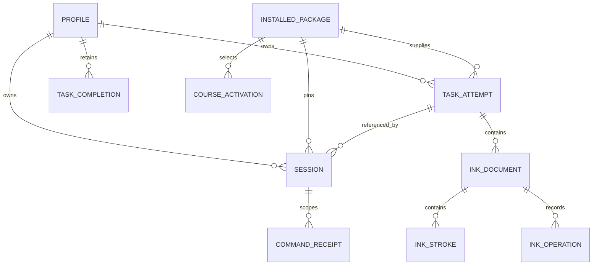

# Adversarial architecture review

Historical review evidence. The current PRD, architecture and normative appendices incorporate later accepted interview decisions and govern implementation. Review-era proposals below do not override those contracts.

**Reviewed:** October 15, 2026

**Scope:** ARCHITECTURE.md, PRD.md, lesson source JSON, lesson transcription, instruction model, and wireframe decisions. Architecture line references refer to the unchanged October 14 document.

**Revision note — October 15, 2026:** The architecture has since been revised. The findings below describe the original version; original line links are historical and may now point elsewhere. The [resolution record](#resolution-record--october-15-2026) maps each finding to the new contracts. This is a specification response, not a second independent review or evidence that application tests passed.

## Intent

Assess whether the proposed architecture is precise and internally consistent enough to implement the production reading application in the PRD, especially its database schema, major libraries/frameworks, curriculum fidelity, durable handwriting, and content updates. The product goal and explicitly pending product choices remain the constraints for this review.

## Verdict

**Revise before implementing the storage and teaching contracts.** The document identifies the main modules, but its database section is an entity inventory rather than a sufficiently specified schema, and its technology section is a platform-options table rather than a complete stack. Five groups of actionable findings follow. These are specification defects and omissions; no running application exists here in which to establish a critical implementation bug.

The architecture was not edited. Proposed relationships and technology-inventory rows below are review recommendations, not newly selected product decisions.

## Reviewers

- **Reviewer A:** inherited available model; five warning findings, no critical findings or nits.
- **Reviewer B:** inherited available model; five warning findings, no critical findings or nits.
- **Lead:** verified the findings against the local documents, checked the lesson inventory, consolidated overlap, and evaluated additional boundary cases.

The interrogate skill's default external models were unavailable through the agent interface. These were separate review passes using the available model, so agreement is corroboration, not evidence of model diversity. The selective-review case was also explicitly put to both reviewers during follow-up.

## Act On

### A1. [warning] Sessions cannot identify their active attempt, and the schema leaves ownership and progress rules undefined

**Location:** [storage inventory](/Users/tig/Desktop/tigran/readatthree/ARCHITECTURE.md:338), especially lines 343–349; [Replay](/Users/tig/Desktop/tigran/readatthree/ARCHITECTURE.md:211).

**Raised by:** A, B; verified by lead.

`session` stores profile/task/package identifiers but no attempt reference. Replay creates another `task_attempt`; each attempt can own different milestones and writing documents. `task_attempt` also has no specified session association or current-attempt marker.

**Failure case:** finish writing Task 6, start a replay on the same release, draw a new model, and restart. Both attempts match the session's profile/task/release. The documented records do not determine which milestones or ink to restore. Selecting the latest record introduces another undocumented rule and ordering field.

The broader schema also omits field types, required/nullable fields, explicit primary/composite keys, cardinalities, constrained statuses, uniqueness, deletion rules, and indexes. “Use foreign keys or equivalent validation” does not specify which combinations must agree. Independent foreign keys to a valid profile and a valid attempt would still allow a document to reference another profile's attempt unless their ownership relationship is checked.

The optional skip result needs an authoritative query rule too. A skip lives in an attempt's optional status, whereas completion has its own durable record. It is unclear whether beginning an unfinished replay after a skip changes lesson completion or next-lesson access. Similarly, a permanent completion receipt cannot depend solely on a command-receipt row that may be pruned.

**Required revision:** add an explicit current-attempt association and define its creation/assignment transaction. Specify the logical schema and invariants in the database-contract appendix below. This work is possible before selecting SQLite versus IndexedDB.

### A2. [warning] The persisted stroke state cannot express the documented recovery behavior

**Location:** [portable stroke contract](/Users/tig/Desktop/tigran/readatthree/ARCHITECTURE.md:295), [checkpoint recovery](/Users/tig/Desktop/tigran/readatthree/ARCHITECTURE.md:312), and [ink_stroke row](/Users/tig/Desktop/tigran/readatthree/ARCHITECTURE.md:347).

**Raised by:** A; verified by lead.

The portable contract has three states: `capturing`, `finished`, and `interrupted`. The storage inventory lists only an interrupted flag. Recovery is supposed to recognize a persisted capturing stroke and convert it to interrupted.

**Failure case:** the app saves a checkpoint during a long gesture and dies before pointer-up. An `interrupted=false` boolean cannot distinguish this unfinished stroke from a finished one. The recovery rule needs information the listed persisted representation does not contain.

**Required revision:** persist the three-state status explicitly. Specify how point chunks are ordered, how finalization is committed, and how a recovered partial stroke enters undo history exactly once. Include a crash after checkpoint but before pointer-up in the store contract tests.

The table explicitly lists only “important fields,” so this is a contract inconsistency to resolve, not proof of implemented data loss.

### A3. [warning] Source-required selective review is missing, and repeat/correction state is only described in prose

**Location:** [TeachingNode](/Users/tig/Desktop/tigran/readatthree/ARCHITECTURE.md:133), [actions and flow](/Users/tig/Desktop/tigran/readatthree/ARCHITECTURE.md:198), and [persisted state](/Users/tig/Desktop/tigran/readatthree/ARCHITECTURE.md:343).

**Raised by:** A and B for selective review; B for typed repeat/correction contracts; verified by lead.

Repeat handles the current item or a fixed authored group. Help handles the immediate correction/retest. Neither defines selecting an arbitrary subset of earlier items for end-of-task practice.

**Evidence:** [Lesson 1, Task 2, Step 8](/Users/tig/Desktop/tigran/readatthree/output/markdown/lessons-01-06.md:73) and [Lesson 2, Task 2, Step 9](/Users/tig/Desktop/tigran/readatthree/output/markdown/lessons-01-06.md:167) require reviewing words the child had trouble with. If motorboat and sister need review, reaching the final “if” item leaves no defined command or saved continuation for that subset. Inferring difficulty only from Help would miss parent-observed difficulty handled through ordinary repetition.

The document also distinguishes mandatory Again, counted/ranged practice, and repeat-until-firm, but `repeatEdge`, generic branch state, and milestone state do not define their payloads or evaluation rules. Correction selectors, return context, and milestone behavior after Back remain unspecified.

**Required revision:** define a source-authored review node with parent-selected stable item IDs, or an equivalent explicit review queue, with its return and exit behavior persisted. Add language-neutral repeat-policy and correction-context types. State what Back restores and which milestones/counters remain valid after Back, correction, replay, and content migration. Parent selection remains the judgment source; no automated assessment is needed.

The graph approach can represent these behaviors. The missing contract is the finding.

### A4. [warning] Activating later lesson batches can produce an incomplete course catalog

**Location:** [CourseDefinition](/Users/tig/Desktop/tigran/readatthree/ARCHITECTURE.md:116), [course_activation](/Users/tig/Desktop/tigran/readatthree/ARCHITECTURE.md:342), and [package installation/update contract](/Users/tig/Desktop/tigran/readatthree/ARCHITECTURE.md:384).

**Raised by:** A, B; verified by lead.

A course has one active package hash, but later deliveries are described as batches. The document never requires each replacement package to contain all previously released lessons, nor does it define dependencies or a catalog composing multiple packages.

**Failure case:** a Lessons 7–12 package is activated as the new course package. A new replay of Lesson 1 now needs content absent from that package. Retaining an old package for a pinned unfinished session does not define how a new session finds Lesson 1. This conflicts with the PRD's requirement that completed lessons remain available for repetition.

**Required revision:** choose one composition rule. The simpler starting rule is cumulative course packages, optionally deduplicating immutable asset bytes. Alternatively, activate a versioned catalog mapping every available lesson to an exact package and validated dependency set. Include the whole catalog in offline-readiness and garbage-collection rules. Do not assume that a delta package was already selected; the defect is that neither rule is specified.

### A5. [warning] Major implementation libraries and frameworks are not inventoried

**Location:** [platform bindings](/Users/tig/Desktop/tigran/readatthree/ARCHITECTURE.md:79), [content tooling](/Users/tig/Desktop/tigran/readatthree/ARCHITECTURE.md:424), and [build/release](/Users/tig/Desktop/tigran/readatthree/ARCHITECTURE.md:553).

**Raised by:** A, B; verified by lead.

SwiftUI, PencilKit, React Native, SQLite, Canvas/Pointer Events, and IndexedDB are named as options. The database driver, migration mechanism, cross-platform ink implementation, content compiler runtime, schema validator, package serialization/signing implementation, test frameworks, and build/release tools are not identified. Even the web application framework or a deliberate platform-APIs-only choice is absent.

There is no package manifest or application project in this repository from which to recover those choices. The document therefore cannot currently demonstrate that its major dependencies are listed.

**Required revision:** add the stack inventory below, with each row marked selected, candidate, pending, or unnecessary. Select platform-neutral tooling independently where practical. Resolve platform-dependent rows after the user's platform decision. A deliberate custom implementation or platform API is a valid choice; this is not a requirement to add a library for every row.

## Consider

These are additional concrete decisions to close as the contracts are implemented. They have less evidence or a narrower impact than the five groups above.

| ID  | Location                                                                                                                                                              | Gap and consequence                                                                                                                                                                                                                                              | Recommended decision                                                                                                                                                                                                                        | Origin / judgment                                                                                                 |
| --- | --------------------------------------------------------------------------------------------------------------------------------------------------------------------- | ---------------------------------------------------------------------------------------------------------------------------------------------------------------------------------------------------------------------------------------------------------------- | ------------------------------------------------------------------------------------------------------------------------------------------------------------------------------------------------------------------------------------------- | ----------------------------------------------------------------------------------------------------------------- |
| C1  | [writing barrier](/Users/tig/Desktop/tigran/readatthree/ARCHITECTURE.md:242), [ink input](/Users/tig/Desktop/tigran/readatthree/ARCHITECTURE.md:306)                  | Finalizing and flushing a pointer does not state whether a new pointer may begin before the teaching/phase commit. A new stroke could be assigned to the old phase during that interval.                                                                         | Define an input fence during the barrier, validate document revision/phase with the transition, and reopen input on success or recovery.                                                                                                    | Lead; genuine concurrency boundary, dependent on adapter design.                                                  |
| C2  | [command identity](/Users/tig/Desktop/tigran/readatthree/ARCHITECTURE.md:200), [profile generation](/Users/tig/Desktop/tigran/readatthree/ARCHITECTURE.md:354)        | Deletion uses a profile generation, but commands, queued ink edits, and receipts do not specify how they carry or check it. Revision alone is insufficient if reset reuses a scope and revision.                                                                 | Carry the relevant generation through asynchronous writes and compare it transactionally; alternatively define identities that are never reused and equivalent rejection rules. Define receipt scope and command-payload mismatch handling. | Lead; the intended protection already exists in prose, its enforcement is missing.                                |
| C3  | [long strokes/history](/Users/tig/Desktop/tigran/readatthree/ARCHITECTURE.md:304), [save failure](/Users/tig/Desktop/tigran/readatthree/ARCHITECTURE.md:376)          | Long gestures, checkpoints, saved replays, and reversible clear lack resource/retention limits. Clear may retain all payloads for Undo, so it need not free storage during a disk-full failure.                                                                  | Define supported point/document limits, buffered-write bounds, history compaction, and parent-controlled cleanup of older work. Keep durable strokes separate from disposable caches.                                                       | A and lead; no evidence that ordinary expected usage already exceeds capacity.                                    |
| C4  | [installation protocol](/Users/tig/Desktop/tigran/readatthree/ARCHITECTURE.md:402), [startup](/Users/tig/Desktop/tigran/readatthree/ARCHITECTURE.md:374)              | Package files/cache and the database activation record use different storage systems. “Publish” does not specify a durable publication primitive or reconciliation of installed-but-missing and staged-but-present states.                                       | Define platform-specific publication and restart reconciliation. Test both sides of the publication/database boundary and keep a usable fallback or exact-package repair path.                                                              | Lead; missing assets are already recognized, so this is a protocol detail rather than an absent failure category. |
| C5  | [progress queries](/Users/tig/Desktop/tigran/readatthree/ARCHITECTURE.md:71), [lesson completion](/Users/tig/Desktop/tigran/readatthree/ARCHITECTURE.md:215)          | Map status and resume destinations have no specified query/policy. Sequential unlocking, task access, multiple paused attempts, and which release a completed-task replay opens remain unclear.                                                                  | Give deterministic rules/examples for next lesson, next task, resume, explicit replay, and completed/skipped precedence. Define whether access restrictions are presentation or domain rules.                                               | Lead; affects implementation consistency, but some access policy is a product choice.                             |
| C6  | [commit-before-projection](/Users/tig/Desktop/tigran/readatthree/ARCHITECTURE.md:251), [failure behaviors](/Users/tig/Desktop/tigran/readatthree/ARCHITECTURE.md:486) | “Retry,” “unavailable,” and “explicit recovery action” do not yet describe usable parent paths for corruption, repeated save failure, or missing offline assets. Correction display also waits for a commit, with no defined behavior during a slow/failed save. | Specify the recovery actions, preserved data, input state, and Help/cue-cancellation behavior while saving. State device-loss guarantees separately from local restart recovery.                                                            | Lead; backup is optional, but P4 still requires a usable failure path.                                            |
| C7  | [compatibility policy](/Users/tig/Desktop/tigran/readatthree/ARCHITECTURE.md:420), [release tests](/Users/tig/Desktop/tigran/readatthree/ARCHITECTURE.md:549)         | Retained sessions must remain readable across app releases, but the test matrix does not explicitly pair new binaries with old content schemas, DB versions, and ink codecs.                                                                                     | Define supported compatibility combinations and fixtures for old pinned correction/writing states, upgrade, and attempted rollback. Include completed documents when deciding package retention.                                            | Lead; extends an existing requirement into testable acceptance.                                                   |

## Database contract that should be added

This is a proposed minimum contract, not executable DDL. Selecting the physical database is still pending. The architecture should specify equivalent invariants for either binding.

The diagram illustrates the missing attempt relationship. Active-session uniqueness, session archival, and non-session command scopes must still be specified; it does not select those policies.

| Record                                              | Minimum additions/decisions                                                                                                                                                                                                                                                                                          |
| --------------------------------------------------- | -------------------------------------------------------------------------------------------------------------------------------------------------------------------------------------------------------------------------------------------------------------------------------------------------------------------- |
| `profile`                                           | Explicit identifier type and PK; generation range; preference payload version. Decide whether clearing saved work retains the profile with an incremented generation or deletes it and creates a new identity.                                                                                                       |
| `installed_package`                                 | `package_hash` PK; `course_id`; release identity scope/uniqueness; schema/capability versions; constrained installation states; verified runtime location. Keep package identity immutable.                                                                                                                          |
| `course_activation`                                 | `course_id` PK; exact package/catalog reference; same-course validation; replacement preconditions and rollback behavior.                                                                                                                                                                                            |
| `session`                                           | PK; profile/generation; pinned package; explicit `current_attempt_id`; current teaching position and checkpoint-payload version; status; nonnegative revision. Choose and enforce active-session cardinality, e.g. one per profile/course.                                                                           |
| `task_attempt`                                      | PK; profile/generation; task identity and exact content/package identity; lifecycle status; versioned milestones/repeat/correction/review state. Define how attempts are ordered if ordering is used by queries.                                                                                                     |
| `task_completion` or equivalent durable task result | Declare the unique key and completed/skipped representation or authoritative historical query. Specify replay precedence and accepted content revision. Retain durable receipt data independently of prunable idempotency receipts. A dedicated lesson row is unnecessary if lesson status is derived unambiguously. |
| `ink_document`                                      | PK; composite ownership relationship to attempt; target identity; exact content reference; phase enum; bounds; codec; revision; authoritative history cursor. Choose one document per attempt/target or an explicit additional document-attempt index.                                                               |
| `ink_stroke`                                        | PK; document ownership; layer enum; `capturing/finished/interrupted` status; stroke order; versioned point/brush representation; chunk order/finalization rules if chunked.                                                                                                                                          |
| `ink_operation`                                     | PK; document FK; unique sequence per document; typed operation payload; payload version; applied/redo semantics. Define edit-after-Undo behavior and compaction relative to a document baseline.                                                                                                                     |
| `command_receipt`                                   | Composite scope/command uniqueness; generation; expected/resulting revision; command identity/payload check; result encoding; retention rule. Define scopes for actions that create or delete sessions.                                                                                                              |
| `schema_migration`                                  | Unique version and migration identity; transaction/recovery rules for recording success; supported upgrade paths. Ensure the completion marker cannot commit before the actual upgrade.                                                                                                                              |

The schema must also state:

1. **Content membership:** task/node/item/target IDs must belong to the pinned content. They live in packages, so ordinary SQL foreign keys cannot establish that unless a content index is also materialized in the database. Specify which layer validates it.
2. **Ownership:** a session, its current attempt, and its writing documents must agree on profile, generation, task, and content identity. Use composite constraints or validated transactional writes.
3. **Atomicity:** create/assign a replay attempt atomically; commit attempt milestones, session position, durable task outcome, document-phase change, and receipt together when a transition affects them. Continuously committed ink before advancement is valid.
4. **Deletion:** list cascade/restrict behavior for personal rows, including receipts and undo payloads. Content packages are shared and are collected separately.
5. **Query indexes:** list indexes for active-session lookup, attempts by profile/task, task-result lookup, documents by attempt/target, ordered strokes/operations, receipts by scope/command, and package-reference retention checks.
6. **Binding parity:** specify the IndexedDB transaction scopes and validators that implement the same invariants. For SQLite, explicitly enable and verify foreign-key enforcement on each connection; do not rely on defaults. [SQLite foreign-key documentation](https://www.sqlite.org/foreignkeys.html).

Field types, nullability, enum values, payload versions, and constraints should be written for every column/store field. A language-neutral schema plus binding mappings is sufficient until the platform is selected; native DDL can then become the executable reference.

## Technology-stack inventory that should be added

**Current status:** the names below are documented options, not installed dependencies. Versions cannot be verified because no application manifests or build files exist.

| Responsibility                         | Named today                                                            | Missing stack declaration                                                                                                                                                      |
| -------------------------------------- | ---------------------------------------------------------------------- | ------------------------------------------------------------------------------------------------------------------------------------------------------------------------------ |
| Runtime and language                   | No explicit runtime/language inventory                                 | Swift/toolchain for an iPad binding; JavaScript/TypeScript runtime and language policy for a React Native/web binding; content-tooling runtime independently.                  |
| Application framework                  | SwiftUI or React Native; generic web shell                             | Selected framework and supported version policy after platform choice. Explicitly state whether Expo or another application framework is used if it becomes part of the stack. |
| Navigation and UI state                | Routes, session coordinator, subscriptions                             | Navigation mechanism/library and whether state coordination is custom. Do not add a global state library without a need.                                                       |
| Ink input/rendering                    | PencilKit/custom, unnamed native/GPU adapter, or Canvas/Pointer Events | Actual renderer/module, native integration, canonical-codec bridge, supported device/OS floor, and ownership of Undo.                                                          |
| Database engine and access             | SQLite or IndexedDB                                                    | Driver/library or platform API, connection/transaction ownership, supported SQLite/browser floor.                                                                              |
| Migrations                             | Generic migration contract                                             | Migration runner/library or custom implementation, version source, and fixture mechanism.                                                                                      |
| Content compiler                       | Structured files and local command                                     | Language/runtime, package format, compiler entry point, schema-validation library or explicit custom validation.                                                               |
| Serialization and package verification | Canonical serialization, hashes, signatures                            | Exact encoding/canonicalization, hash/signature algorithms, implementation libraries/platform crypto, and trust-key format.                                                    |
| Assets and typography                  | Audited glyphs/diagrams                                                | Runtime formats, rendering/decoding dependencies, font handling, provenance, and packaging tools.                                                                              |
| Offline installation/files             | Package installer and optional host                                    | Filesystem/download/archive/cache implementations. A web choice also needs an explicit application-shell offline mechanism, not only cached lesson assets.                     |
| Unit/domain/property tests             | Test categories only                                                   | Actual test runner and property-testing approach/library, or custom generators.                                                                                                |
| Storage/integration tests              | Real-driver contract suite                                             | Real database harness and failure-injection mechanism.                                                                                                                         |
| UI/device/performance tests            | End-to-end and physical-device checks                                  | Automation framework(s), platform instrumentation, and the procedure for input-to-presented-ink timing.                                                                        |
| Build and package management           | Lockfiles and reproducible builds in principle                         | Package manager(s), lockfiles, platform build tools, lint/format/type-check tools, and toolchain pinning.                                                                      |
| CI, signing, distribution              | Generic CI and release pipeline                                        | CI provider, app/content build/signing mechanisms, secret storage, release artifact retention, and selected distribution channel.                                              |
| Diagnostics                            | Allowlisted bounded local reports                                      | Logging/reporting implementation and any third-party SDK. Explicitly say none if no external diagnostics service is used.                                                      |

For every selected major dependency record its responsibility, supported version policy, license, relevant platform limitations, and the checks required on upgrade. Avoid listing optional services as installed. Accounts, billing, a server database, and cloud synchronization are unselected product features, so no provider needs to be invented for them.

## Targeted acceptance cases

These are recommended additions to the existing test plan, not tests claimed to have run:

1. Complete writing, replay it on the same release, pause midway, restart, and restore only the explicitly active attempt; retain earlier completion and ink.
2. Skip optional writing, start an unfinished replay, restart, and verify the documented lesson-result and next-lesson policy.
3. Attempt to attach an ink document to another profile's attempt; reject it without a partial write.
4. Kill the app after a capturing-stroke checkpoint but before pointer-up; recover one interrupted stroke and one coherent Undo action.
5. Select nonadjacent troublesome items, review one, restart, resume the remaining queue, and exit through the authored route.
6. Exercise mandatory Again, counted practice, repeat-until-firm, correction retest, and Back; verify milestone/counter semantics.
7. Activate later lesson content, go offline, and open both new lessons and a new replay of an earlier completed lesson.
8. Begin a new pointer gesture during the flush/phase-transition interval; enforce the documented input fence and phase ownership.
9. Queue an edit, remove/reset the profile, deliver the old callback, and verify that no personal record is recreated.
10. Interrupt package publication before and after installed/activation metadata commits; reconcile to usable verified content on restart.
11. Undo, add a new stroke, restart, and verify the discarded redo branch, operation order, and durable document baseline.
12. Upgrade an app with an old pinned correction and an old writing codec; restore them or follow the explicit supported migration path.

## Noted

- Verified the source JSON contains six lessons with task counts `[6, 7, 8, 7, 9, 8]`, totaling 45 tasks and six writing tasks. The architecture's inventory is correct.
- The document already records the Lesson 2 / Task 3 / Step 6 transcription ambiguity. It remains a known content-publication blocker, not a newly discovered architectural omission.
- The ink-latency target already requires physical-device measurement and acknowledges frame-callback limitations. The remaining need is a concrete supported-device matrix and measurement procedure once the platform is selected.
- No additional substantiated security defect emerged from document review. Signatures, nonexecutable content, archive/path validation, local-first personal data, diagnostic exclusions, and revision checks are already addressed at the policy level. Implementation must still establish them.

## Dismissed

- **“Pick a platform now or the architecture is invalid.”** The PRD explicitly leaves the first platform set to the user. Record candidate stacks and unresolved decisions accurately; do not choose on their behalf.
- **“A production app must have a backend, login, cloud backup, or subscriptions.”** None is necessary for the selected local-first scope. Device-loss recovery can remain unselected if the actual guarantee is stated.
- **“The separate ink flush and teaching transaction inherently corrupt state.”** Extra committed ink with an unchanged teaching position is a valid recovery state. The relevant open question is the input/phase fence, not the mere existence of two commits.
- **“Pinned packages cannot be repaired.”** The architecture already allows verified repair and keeps exact content identities. Specify the concrete repair mechanism during platform/distribution selection.
- **“Replace the graph with a universal three-stage lesson template or full event sourcing.”** Neither follows from the findings. The supplied curriculum needs distinct turn/repeat/correction patterns, and transactional snapshots remain a viable design.
- **“Every undefined implementation detail is a blocker.”** Routine local implementation choices are not findings. The accepted issues affect cross-module contracts, required teaching behavior, or the user's specific schema/stack review request.

## Agreement Map

| Issue                                                            | A                         | B                     | Lead disposition                                                             |
| ---------------------------------------------------------------- | ------------------------- | --------------------- | ---------------------------------------------------------------------------- |
| Missing session-to-attempt relationship / incomplete DB contract | Raised                    | Raised                | Act On A1; strongest independent agreement.                                  |
| Capturing/finished/interrupted persistence mismatch              | Raised                    | Not raised            | Act On A2; directly verifiable contract mismatch.                            |
| Selective review of troublesome items                            | Confirmed                 | Confirmed             | Act On A3; checked against actual source steps, including follow-up.         |
| Typed repeat/correction rules and saved state                    | Covered in schema details | Raised separately     | Merge into A3.                                                               |
| Cumulative versus delta package composition                      | Raised                    | Raised                | Act On A4; neither composition rule is selected.                             |
| Incomplete major dependency/tooling inventory                    | Raised                    | Raised                | Act On A5; platform deferral is valid, missing inventory remains actionable. |
| Storage/history budgets                                          | Lower confidence          | Not raised            | Consider C3; no measured capacity failure.                                   |
| New input during phase barrier                                   | Not raised                | No additional finding | Consider C1 from lead; resolve with the selected adapter.                    |
| Mandatory backend or platform selection                          | Rejected                  | Rejected              | Dismissed; conflicts with the product contract.                              |

The common pattern is underspecified contracts rather than a need to replace the modular local-first design. The next architecture revision should make those contracts testable and list each major technology with an honest selection status.

## Resolution record — October 15, 2026

**Status: addressed in the architecture specification.** The original review above is preserved. This response has not been independently re-reviewed, and runtime acceptance remains unexecuted because application/storage/ink implementation does not yet exist. The platform and optional services remain pending product choices; no platform/backend was selected to close a documentation finding.

| Finding                                 | Revision                                                                                                                                                                                                                                                                           | Required implementation evidence                     |
| --------------------------------------- | ---------------------------------------------------------------------------------------------------------------------------------------------------------------------------------------------------------------------------------------------------------------------------------- | ---------------------------------------------------- |
| A1 · session/attempt/schema/results     | Architecture §8.1, §8.5; [database contract](docs/architecture/DATABASE_CONTRACT.md): explicit current attempt, full typed logical fields/keys, ownership tuples, atomic assignment, result precedence, deletion, indexes, receipt scope/retention, binding parity.                | [R01–R03, R09, R13](docs/architecture/ACCEPTANCE.md) |
| A2 · stroke recovery/history            | Architecture §7.3–7.5; database contract's stroke/history protocol: persisted three-state status, ordered chunks, finalization/recovery transaction, unique AddStroke, baseline/cursor/redo rules.                                                                                 | R04, R11                                             |
| A3 · selective review/repeat/correction | Architecture §5.5: typed policies, correction/retest contexts, stable parent-selected review queue and exits, Back/occurrence semantics, explicit migration requirements. Source L1 T2 step 8 and L2 T2 step 9 checked against transcription.                                      | R05–R06, R12                                         |
| A4 · cumulative course catalog          | Architecture §9.1–9.3: cumulative package rule, full asset closure, no delta-only activation or shrinking fallback/rollback; exact old-session/document pinning.                                                                                                                   | R07, R10                                             |
| A5 · technology inventory               | Architecture §3 and [stack inventory](docs/architecture/STACK.md): selected neutral tooling, named runtime candidates, pending drivers/modules/platforms, versions/licenses/upgrade gates, exact serialization/signing, build/CI/diagnostics inventory. Nothing claimed installed. | R16 and selected-platform decision                   |
| C1 · input/phase fence                  | Architecture §6 and §12 sequence: fence before flush, transactional phase/revision/epoch checks, reopen only committed state, failure retention.                                                                                                                                   | R08                                                  |
| C2 · reset/deletion/receipt identity    | Database contract: generation-tagged writes, administrative scopes, payload-hash collision rejection, stale retry behavior after receipt pruning.                                                                                                                                  | R09                                                  |
| C3 · resource/history/cleanup           | Architecture §7.5 and database contract: explicit point/document/buffer budgets, 128-operation history compaction, no automatic personal expiry, parent cleanup, Clear retains undo bytes. Budgets are proposed engineering limits, not measured performance.                      | R11, R15                                             |
| C4 · publication reconciliation         | Architecture §9.2: native publication/DB boundary, web cache protocol and offline shell, staged/orphan/missing reconciliation and repair/fallback conditions.                                                                                                                      | R10                                                  |
| C5 · deterministic map/resume/access    | Architecture §8.5 and database contract: durable-result queries, sequential access enforced in domain, explicit cursor and session scopes, replay return order and release selection.                                                                                              | R02, R13                                             |
| C6 · usable recovery                    | Architecture §12 parent recovery table: immediate Help/cue cancellation and read-only source preview, idempotent Retry, corrupt-store/missing-asset/update actions, preserved input/data, explicit local/device-loss guarantees.                                                   | R14                                                  |
| C7 · compatibility/retention            | Architecture §9.4 and stack artifact policy: published-version fixtures, old pinned state/ink and completed drawings, forward upgrade and safe refusal of incompatible rollback.                                                                                                   | R12                                                  |

The [acceptance matrix](docs/architecture/ACCEPTANCE.md) expands all twelve original targeted cases into observable assertions and harness requirements (R01–R12), plus map, recovery, limits, and dependency cases (R13–R16). Physical database DDL, adapter code, actual lockfiles, and device measurements follow the platform decision and implementation; the logical contract is now specified without pretending those artifacts exist.

Documentation checks performed on this revision: all 33 PRD requirement IDs remain mapped in architecture §15; all twelve A/C findings have resolution rows; all sixteen acceptance cases have unique ordered IDs; local file-link targets exist and code fences/main section numbering are balanced. These checks validate document consistency, not application behavior.

### Subsequent user technology decision — October 15, 2026

The user subsequently selected React Native/Expo for multiplatform distribution, with the entire application implemented first as a React SPA, using TypeScript, shadcn/ui, React Query and Drizzle. This supersedes references above to an undecided platform/framework and the earlier IndexedDB option. Current architecture/stack/database contracts select SQLite for both stages: a local WASM/OPFS worker bridge for the SPA and expo-sqlite for Expo, retaining all ownership/transaction/recovery invariants. React Query caches committed repository reads; it is not the durable lesson engine. Web shadcn screens require native counterparts. Prettier defaults and commit hooks are configured; ESLint is excluded. Root tooling now has a manifest/lockfile; application projects remain unimplemented. The review findings and original review evidence remain historical; this stack change is a user decision, not independent reviewer approval.
